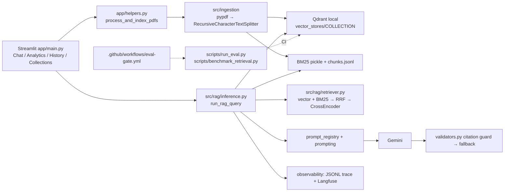

# PROJECT_AUDIT.md — DocMind (PDF-Corpus-Chat)

**Date:** 2026-10-18
**Auditor:** Buffy (Codebuff) — multidisciplinary audit (architecture, engineering, QA, security, UX, product, performance, DevOps)
**Method:** Full repository inspection, static evidence with file:line references, local test execution, and runtime reproduction where possible (Streamlit `AppTest` harness, direct function reproduction). Every finding is labelled **Confirmed** (reproduced or proven by an executed check / verified library semantics) or **Suspected** (plausible, not yet reproduced — carries a verification task, never a fix).
**Baseline verification:** `venv/Scripts/python.exe -m pytest tests/ -q` → **166 passed, 11 warnings, 30.68s** (warnings are third-party DSPy deprecations only).

**Working agreement for this document:** one issue is implemented at a time, each on its own git branch, verified, reported, and gated on explicit user approval. This file is updated per issue in the Implementation Checklist (bottom).

---

## A. Project Understanding

### Product overview
DocMind is a self-hosted, single-user Streamlit application for chatting with multiple PDFs. Users upload PDFs into **collections** (independent knowledge bases), ask questions, and receive **citation-backed answers** (`[file.pdf | page N]` per sentence) that are validated against the retrieved chunks before display. It ships with retrieval-quality tooling: a hybrid BM25 + vector retriever fused with RRF and reranked by a cross-encoder, an LLM-as-judge evaluation suite (DSPy), a golden-dataset CLI evaluator, and a GitHub Actions regression gate.

**Intended users:** researchers/knowledge workers (the author's own documents); run locally or via Docker on a trusted network. No multi-tenant, auth, or cloud-storage concepts exist by design.

### Technology stack
| Layer | Technology |
|---|---|
| UI | Streamlit 1.55 (4 tabs + sidebar), custom CSS design system (`app/styles.py`, 891 lines) |
| LLM | Google Gemini `gemini-2.5-flash` via `langchain-google-genai` |
| Embeddings | `GoogleGenerativeAIEmbeddings` (dynamic model discovery per call; default `text-embedding-004`) |
| Vector store | Qdrant **local embedded** (per-collection directory under `vector_stores/`) |
| Keyword search | Custom BM25 (`src/rag/bm25_index.py`), persisted pickle + JSONL corpus |
| Reranker | `cross-encoder/ms-marco-MiniLM-L-6-v2` (module-level singleton, lexical fallback) |
| Evaluation | DSPy 3.2 LLM-as-judge (faithfulness, context relevance, completeness), heuristic metrics, retrieval metrics |
| Observability | Langfuse (optional, guarded no-op) + local JSONL trace sink |
| Infra | Docker multi-stage build, docker-compose (app + Langfuse + Postgres), GitHub Actions |

### Architecture & data flow

### Major modules & dependencies
- `app/` — Streamlit shell: `main.py` (entry), `state.py` (session defaults), `helpers.py` (ingestion + collection CRUD), `views/chat.py` (chat + sidebar), `views/collections.py`, `views/history.py`, `views/evaluation.py`, `styles.py` (CSS). `app/eval_dashboard.py` is an **orphaned** second entrypoint (referenced nowhere).
- `src/ingestion/` — `pdf_loader.py` (per-page extraction stats), `chunking.py` (page-aware chunks).
- `src/rag/` — `inference.py` (pipeline orchestration), `retriever.py`, `fusion.py` (RRF), `reranker.py`, `bm25_index.py`, `vector_store.py`, `embeddings.py`, `prompt_registry.py`, `prompting.py`, `validators.py`.
- `src/eval/` — `evaluator.py`, `metrics.py` (DSPy), `retrieval_metrics.py`, `entailment.py`.
- `src/observability/` — `langfuse_guard.py` (all-or-nothing Langfuse activation), `tracing.py`, `store.py`.
- `scripts/` — `run_eval.py` (CLI gate, exit codes 0/1/2), `benchmark_retrieval.py` (4 strategies, recall gate), `download_fixtures.py`, Windows `setup.ps1`/`run.ps1`.
- `tests/` — 9 files, 166 tests, pure-logic only (fusion, validators, retriever, reranker, BM25, retrieval metrics, entailment, inference no-docs path, langfuse guard).

### Core user journeys
1. **Onboard a corpus:** create collection → upload PDFs → pipeline extracts/chunks/embeds → Qdrant + BM25 + `metadata.json` written → chat.
2. **Ask questions:** hybrid retrieval → Gemini → citation guard → answer with numbered citation pills, source cards, latency badges → appended to session history.
3. **Manage collections:** inspect stats, delete collections, switch active collection (sidebar + Collections tab both write `current_collection`).
4. **Review history:** filter/search session chat, export JSON/TXT, semantic document search.
5. **Evaluate:** in-app batch evaluation (Analytics tab) and CLI/CI golden-dataset gate with LLM-judge metrics + retrieval benchmark.

### How to run / test / build
- Run: `streamlit run app/main.py` (needs `.env` with `GOOGLE_API_KEY`), or `docker compose up --build` → http://localhost:8501
- Test: `pytest tests/ -v` (venv: `venv/Scripts/python.exe -m pytest tests/ -q`) — **verified: 166 passed**
- Eval CLI: `python scripts/run_eval.py --collection X --mode hybrid ...`; benchmark: `python scripts/benchmark_retrieval.py ...`
- CI: `.github/workflows/eval-gate.yml` (unit subset → fixture ingestion → eval gate → benchmark with `continue-on-error`)

---

## B. Audit Report

### B1. Confirmed bugs (executed reproduction or verified code semantics)

| ID | Sev | Issue | Evidence | Root cause | Impact | Recommended fix |
|---|---|---|---|---|---|---|
| ISSUE-001 | **P0** | Re-ingesting PDFs into an existing collection **diverges the two indexes**: Qdrant **appends** new points (langchain-qdrant `from_texts(..., force_recreate=False)` default — verified in installed source `venv/Lib/site-packages/langchain_qdrant/qdrant.py` `construct_instance()`: if the collection exists it is validated but never recreated, then points are added), while `save_chunk_corpus()` **overwrites** `chunks.jsonl` with `"w"` mode ([bm25_index.py:123](src/rag/bm25_index.py#L123)) and rebuilds BM25 from only the new batch; `metadata.json` is also overwritten ([helpers.py:121-122](app/helpers.py#L121), [helpers.py:149-153](app/helpers.py#L149)) | `app/helpers.py::process_and_index_pdfs`; verified library defaults | Upload 2 batches → duplicate vectors for re-uploaded files, BM25 serving only the newest batch, RRF double-counting duplicated chunk keys (`fusion.ingest` sums per key), Collection-tab stats showing only the last upload | Per-file replace + append (see §C decision D1) keeping Qdrant, BM25 corpus and metadata in sync |
| ISSUE-002 | P1 | In-app **batch Evaluation crashes** with `TypeError` | Reproduced: `build_report([{'question':'q'}])` → `TypeError: build_report() missing 3 required positional arguments: 'retrieval_mode', 'top_k', and 'results'`; call site [evaluation.py:201](app/views/evaluation.py#L201) passes a single positional list vs signature `build_report(collection_name, retrieval_mode, top_k, results)` ([evaluator.py:135](src/eval/evaluator.py#L135)) | Copy-paste signature drift between `app/` and `src/eval/` | "Run Evaluation" button always throws after computing answers; feature completely broken | Pass keyword args + collection/mode/top_k; add a wiring test |
| ISSUE-003 | P1 | Asking the **same question twice crashes the entire page** | Reproduced on the real entrypoint: `AppTest.from_file('app/main.py')` with two identical history entries → `streamlit.errors.StreamlitDuplicateElementKey: key='up_4944749187403701325'` | Feedback buttons keyed `f"up_{hash(question)}"` / `f"dn_{hash(question)}"` ([chat.py:469](app/views/chat.py#L469), [chat.py:476](app/views/chat.py#L476)); rendered once per history entry | Any repeated question bricks the Chat tab (all tabs render in one script) | Key by history index (e.g., `f"up_{idx}_{timestamp}"`); add AppTest regression |
| ISSUE-004 | P1 | Sidebar **"Prompt Style" selector has no effect** | Static proof: selector writes `session_state["prompt_type"]` ([chat.py:359](app/views/chat.py#L359)); the pipeline builds prompts from `session_state.prompt_version` ([inference.py:145](src/rag/inference.py#L145)); `prompt_version` is written only by `state.py` defaults and one test — nothing else (`grep -rn prompt_version`) | Two parallel state keys introduced during prompt-registry refactor | Users believe they changed prompt behavior; traces log a `prompt_style` that was not used (misleading observability) | Use one key (`prompt_version`) end-to-end; show active version in UI |
| ISSUE-005 | P1 | **Analytics tab displays fabricated metrics** | Verified: hardcoded benchmark values (`recall: 0.948` etc., [evaluation.py:64](app/views/evaluation.py#L64)), fake trend arrows "↑ +4.2% vs last run" ([evaluation.py:138](app/views/evaluation.py#L138)), and hardcoded card fallbacks (0.89/0.91/1.24/0.87) while the real baseline `evals/baselines/latest.json` is an empty scaffold (`"strategies": {}`, `"n_queries": 0`) | Demo data left in place after the real benchmark pipeline landed | Users (and stakeholders) are shown invented retrieval quality — an integrity problem for a product whose selling point is measurable quality | Decision D2: real data from baseline + session runs, honest empty states |
| ISSUE-006 | P2 | Recent-evaluations table reads **wrong keys** | [evaluation.py:101-102](app/views/evaluation.py#L101) reads `faithfulness_score` and `citation_validity.validity_ratio`; `evaluate_one()` produces `llm_metrics.*` and top-level `citation_validity_ratio` ([evaluator.py:75-83](src/eval/evaluator.py#L75)) | Key drift | Table always shows 0.00 and ⚠️ even for good runs | Read the produced keys; map `llm_metrics` when present |
| ISSUE-007 | P2 | Source-card **relevance badge never renders** | [chat.py:170](app/views/chat.py#L170) reads flat `metadata["rerank_score"]`/`metadata["score"]`; hybrid retrieval stores scores under `metadata["retrieval"]` ([retriever.py:76](src/rag/retriever.py#L76)) | Metadata shape changed when the `retrieval` sub-dict was introduced | The "▲ N% relevance" affordance is dead in the default mode; if revived, raw CE logits formatted `:.1%` would display nonsense (e.g. `−320.0%`) | Read `metadata["retrieval"]["rerank_score"]`; normalize for display |
| ISSUE-008 | P2 | History **Semantic Search collection list built from chat history** | [history.py:135](app/views/history.py#L135) derives collections from `chat_history` instead of `get_collections()` | Copy-paste from the filter dropdown above | A fresh user with indexed collections can only search `default` | Use `get_collections()` |
| ISSUE-009 | P2 | **Feedback and history are ephemeral**: 👍/👎 appends to `feedback_data` ([chat.py:470](app/views/chat.py#L470)) that is never persisted, displayed, or exported; chat history lives only in session state and is lost on refresh | grep for `feedback_data` usages (write-only) | Thumbs are a dead affordance; History tab promises a "Session chat log" only implicitly | Decision D3: persist history + feedback to disk (JSONL under a per-collection or global dir), show feedback in History |
| ISSUE-010 | P2 | **Input validation / HTML escaping gaps**: collection names are only space-sanitized (`strip().replace(" ", "_")`) yet flow into `os.makedirs`, `shutil.rmtree` and Qdrant paths → path traversal via `../` ([chat.py create-collection](app/views/chat.py), [collections.py](app/views/collections.py), [vector_store.py:14](src/rag/vector_store.py#L14)); collection names and PDF filenames are interpolated into `unsafe_allow_html` strings unescaped (`_index_status_html`, source-card `title="{fname}"`, history badges) → HTML/attribute injection | Static proof of both sinks; impact bounded to the local machine / own session, but the Docker image binds `0.0.0.0:8501` | Sanitize names to `[A-Za-z0-9_-]` (with graceful handling of pre-existing directories); HTML-escape all interpolated names |
| ISSUE-011 | P2 | **Per-query overheads**: (a) `get_embeddings()` performs a live HTTPS model-discovery call on **every invocation** ([embeddings.py:58](src/rag/embeddings.py#L58)) — one per chat query, one per semantic search, one per ingestion; (b) a new `QdrantClient(path=...)` is opened per query ([vector_store.py:37](src/rag/vector_store.py#L37)) — local mode re-opens storage and takes an **exclusive flock**, released only via GC (`__del__`), a latent `RuntimeError: Storage folder ... already accessed`; (c) BM25 search re-parses the **entire corpus JSONL on every query** ([bm25_index.py:221](src/rag/bm25_index.py#L221)) — contradicting the module docstring's claim of "no corpus re-loading" | Static proof of all three paths | Fixed latency tax on every message, growing with corpus size | Cache the embeddings factory + Qdrant client per collection (explicit close) + corpus rows; measure before/after with call-count tests |
| ISSUE-012 | P3 | **Docs & repo hygiene**: README claims an MIT `LICENSE` file that was deleted (commit `fd3d09f`); README states fixture PDFs are not committed, but 3 PDFs (~3.1 MB) are tracked; README eval defaults (`--citation-validity-threshold 0.90`) differ from CI (`0.65`); README benchmark table is empty placeholders; reranker docstring says "75 tests" (actual: 166); `app/eval_dashboard.py` is an orphaned duplicate of Analytics; unused `img/Robot.jpg` (4.3 MB), legacy `document_metadata.json` and `faiss_index/` are tracked; CI unit-test step runs only 7 of 9 test files (omits `test_entailment.py`, `test_inference.py`) | `git ls-files`, README sections, workflow step list | Trust debt: setup docs mislead; repo weight; CI blind spots | Fix README, remove/retire dead files (with approval), run all tests in CI, add an AppTest smoke test |
| ISSUE-013 | P3 | **Token/cost metrics always zero**: `token_count` is initialized ([state.py:16](app/state.py#L16)) and read ([collections.py:103](app/views/collections.py#L103)) but never written | grep `token_count` | "Total Tokens 0" / "$0.000000" cost cards are meaningless | Capture usage metadata from Gemini responses (`response.usage_metadata`) and accumulate |

### B2. Suspected issues (verification task required before any fix)
| ID | Suspect | Verification task |
|---|---|---|
| SUS-01 | Qdrant local lock collision when two clients on the same path coexist in one run (e.g., ingestion while a search client is alive) → `RuntimeError` | Write a test constructing two clients on one path; then test the ISSUE-011 client cache |
| SUS-02 | Embedding-dimension drift: dynamic model discovery may return a newer model (e.g., 3072-dim) while existing collections were built with 768-dim → retrieval/validation errors | Log the model name at ingestion into metadata; add a dimension check on load |
| SUS-03 | Hand-rolled markdown→HTML in `_process_citations` mis-renders edge cases (nested emphasis, code blocks containing `*`, `[x | page 1]` inside code) | Golden-string unit tests over `_process_citations` |
| SUS-04 | Dependency vulnerabilities (no scan tooling configured) | Run `pip-audit` against `requirements.txt` in a future issue |
| SUS-05 | Live E2E behavior with real Gemini (guard fallback, latency) never verified in this audit | Bounded manual run with API budget, or record as unverified |

### B3. Security & privacy
- **No authentication anywhere.** Dockerfile CMD binds `0.0.0.0:8501`; anyone with network reach can upload, overwrite, or delete collections. Acceptable for a localhost tool; must be documented (and optionally gated) for shared networks — **needs a product decision** (see backlog).
- **Secrets hygiene is good:** no tracked secrets (`git grep` for `AIza…`/`sk…`/hardcoded Langfuse keys → clean); `.env` gitignored and only `GOOGLE_API_KEY` + `OBSERVABILITY_ENABLED` present locally; `.env.example` is a placeholder.
- **Compose file hardcodes** `NEXTAUTH_SECRET=mysecret`, `SALT=mysalt`, Postgres `postgres/postgres`, and exposes Postgres on `5432` — fine for local dev only; must not be reused as-is on a server.
- **Injection surfaces:** PDF content flows into prompts (prompt-injection is inherent to RAG; mitigated only by prompt instructions — no tool execution follows the answer, which caps impact); collection names/filenames flow into HTML (ISSUE-010) and filesystem paths (ISSUE-010).
- **Data handling:** traces write question + answer previews + chunk previews to `logs/rag_traces.jsonl` when enabled (currently enabled in local `.env`) — unredacted document content on disk; acceptable for a personal tool, worth documenting.

### B4. Reliability
- No retries/backoff in the app path: a transient Gemini 503 surfaces as `st.error("Model error: …")` and the user message is rendered but **not persisted** to history (it vanishes on the next rerun). The benchmark script has proper exponential backoff (`retry_on_transient`); the app does not.
- Citation guard is a genuine strength: <0.8 valid-citation ratio → deterministic fallback answer; validated by tests.
- Embedded Qdrant is single-process and single-writer; fine for one user, not for concurrency (and `LARGE_DATA_THRESHOLD` warns at scale).
- Failure observability exists (JSONL traces include `error` fields) but there is no log aggregation/metrics — acceptable at this scale.

### B5. Performance
| Finding | Evidence | Expected cost | Direction |
|---|---|---|---|
| HTTP model discovery per embedding call | [embeddings.py:40-63](src/rag/embeddings.py#L40) | ~100–500 ms added per query + failure mode per call | Cache per process (ISSUE-011) |
| Qdrant client opened per query, lock released via GC | [vector_store.py:30-50](src/rag/vector_store.py#L30) | Storage re-open per query; latent lock errors | Per-collection cached client with explicit lifecycle (ISSUE-011) |
| Full corpus JSONL parse per query | [bm25_index.py:194-228](src/rag/bm25_index.py#L194) | O(corpus) per query despite cache docstring | Cache rows with the index (ISSUE-011) |
| CrossEncoder loaded at import time | [reranker.py:76](src/rag/reranker.py#L76) | 30s test-suite import cost; slow any importing process | Keep (intentional warm-up), document; optional lazy mode |
| Unbounded `chat_history` with full `Document` objects + full re-render each rerun | [chat.py render loop](app/views/chat.py#L415) | O(history) DOM + memory growth per session | Cap history / store slim dicts (backlog) |
No micro-benchmarks were run for these (no baseline harness); fixes in ISSUE-011 must add call-count assertions rather than claimed speedups.

### B6. Code quality & architecture
- **Strengths worth preserving:** strict separation `app/` (UI) vs `src/` (logic); the Langfuse guard pattern (single import point, no-op fallback); citation validation with guarded fallback; per-page extraction stats; versioned prompt registry; golden-dataset + CI gate; retry helper in benchmark; heavy duplication of `build_trace_record(...)` calls in `inference.py` (4 near-identical 25-line blocks) is the main maintainability wart in the pipeline.
- Duplicated collection-creation logic (sidebar vs Collections tab) with different sanitization paths; `render_stats_tab` alias kept "for backward compatibility" but unused; two parallel session keys for prompt version (ISSUE-004).
- Naming/conventions are consistent; typing is adequate for a Python Streamlit app (no mypy/ruff configured — optional backlog item).

### B7. UI/UX & accessibility
- **Works well:** dark design system with clear visual hierarchy; per-message latency badges; citation pills with hover tooltips; empty states in History; native `st.tabs`/`st.expander` navigation keeps keyboard flow functional.
- **Broken/deceiving:** Analytics fabricated data (ISSUE-005), dead prompt selector (ISSUE-004), dead relevance badges (ISSUE-007), zeroed cost cards (ISSUE-013), dead feedback (ISSUE-009), Collections metrics flash then disappear (`st.rerun()` immediately after rendering success metrics).
- **Accessibility gaps:** no `prefers-reduced-motion`, no `:focus-visible`/outline styling in the 891-line CSS; citation pills and tooltips are CSS hover-only (unreachable by keyboard/screen reader); icon-only buttons rely on emoji labels; contrast not audited (unverified).
- Error copy is good ("Please upload and process PDF files first…", "No usable text extracted…").

### B8. Testing & CI
- **166 tests pass** but cover pure logic only. Zero coverage of: views (the four bugs that most affect users all live here), `app/helpers.py` ingestion, `run_rag_query` happy path, and script↔module wiring (`build_report` call).
- CI runs 7 of 9 test files; `test_entailment.py` and `test_inference.py` pass locally but are omitted from the workflow.
- The `AppTest` harness used in this audit (`streamlit.testing.v1`) can drive the real `app/main.py` headlessly — the natural vehicle for view-level regression tests.
- CI benchmark step is `continue-on-error: true` (recently added for 503 flakiness) — the recall gate is therefore **informational, not blocking**; the README still describes it as blocking.

---

## C. Prioritized Improvement Roadmap

**Recorded user decisions**
- **D1 — Ingestion semantics:** per-file replace, append new (re-uploading `foo.pdf` replaces its chunks on both indexes; other files retained; no full rebuild, no naive append).
- **D2 — Analytics content:** real data from `evals/baselines/latest.json` + session evaluation runs, with honest empty states; no fabricated numbers.
- **D3 — Approved quick win:** persist chat history + 👍/👎 feedback to disk. (Working prompt selector and real token tracking remain scheduled as separate issues.)

**Issue register (implement strictly in order, one branch + approval per issue)**

| ID | Pri | Category | Problem | Solution | Verification | Status |
|---|---|---|---|---|---|---|
| ISSUE-000 | — | docs | Audit findings not recorded in repo | This document (`docs/project-audit` branch) | Document contains A–F + register | **Completed** (this commit) |
| ISSUE-001 | P0 | bug/data | Re-ingest diverges Qdrant vs BM25/metadata ([helpers.py:121](app/helpers.py#L121)) | Per-file replace + append: filter-delete Qdrant points by `metadata.source`, merge `chunks.jsonl`, rebuild BM25 once, merge `metadata.json`; injectable embeddings for tests | `tests/test_ingestion_sync.py` (replace/append/consistency/metadata-merge/legacy-row retention) + full suite ≥166 passed | **Completed** 2026-10-18 |
| ISSUE-002 | P1 | bug | Batch eval `TypeError` ([evaluation.py:201](app/views/evaluation.py#L201)) | Keyword call into `build_report`, read `summary`, persist report (no immediate rerun), opt-in LLM-judge toggle | `tests/test_eval_tab.py` (AppTest click, both paths) + suite | **Completed** 2026-10-19 |
| ISSUE-003 | P1 | bug/stability | Duplicate widget key crash on repeated question | Index-based feedback keys | AppTest regression (two identical questions) + suite | Planned |
| ISSUE-004 | P1 | bug | Prompt Style selector no-op | Single `prompt_version` key end-to-end; display active version | Unit test on pipeline prompt selection + manual UI check | Planned |
| ISSUE-005 | P1 | integrity/UX | Fabricated Analytics metrics (D2) | Render real baseline/session data; empty states when absent | AppTest with empty + populated baseline fixtures | Planned |
| ISSUE-006 | P2 | bug | Recent-evals wrong keys | Map `evaluate_one` output keys | Unit test on table builder | Planned |
| ISSUE-007 | P2 | bug | Relevance badge dead | Read `metadata["retrieval"]`, normalize CE logit for display | Unit test on card builder | Planned |
| ISSUE-008 | P2 | bug | Semantic-search collections from history | Use `get_collections()` | AppTest | Planned |
| ISSUE-009 | P2 | feature (D3) | History + feedback ephemeral | JSONL persistence, restore on load, feedback visible in History | Round-trip unit tests | Planned |
| ISSUE-010 | P2 | security | Collection-name traversal + HTML injection | Name sanitizer `[A-Za-z0-9_-]` + HTML escaping of interpolated names | Traversal + escaping tests | Planned |
| ISSUE-011 | P2 | perf | Per-query HTTP discovery / client open / corpus parse | Process-level caches with explicit client lifecycle | Call-count tests + suite | Planned |
| ISSUE-012 | P3 | docs/ci | README inaccuracies, dead files, CI test subset | Fix docs; delete dead files (with approval); CI runs all tests + AppTest smoke | Doc review + workflow lint | Planned |
| ISSUE-013 | P3 | feature | Token/cost always zero | Capture Gemini `usage_metadata`, accumulate `token_count` | Unit test on accumulator | Planned |

**Deferred product decisions (require explicit user input before scheduling):** optional shared-network auth (ISSUE-010-adjacent), history size caps, mypy/ruff adoption, Langfuse compose hardening.

---

## D. Implementation Summary (updated per issue)

### ISSUE-000 — audit document
- Files changed: `PROJECT_AUDIT.md` (new)
- Branch: `docs/project-audit`
- Commands executed this session and results:
  - `venv/Scripts/python.exe -m pytest tests/ -q` → **166 passed, 11 warnings (third-party), 30.68s**
  - `build_report([...])` reproduction → `TypeError: build_report() missing 3 required positional arguments` (**confirmed ISSUE-002**)
  - `AppTest.from_file('app/main.py')` with duplicated history entry → `StreamlitDuplicateElementKey: key='up_…'` (**confirmed ISSUE-003**)
  - `AppTest` button-key micro-repro → same exception class (**key-collision mechanism confirmed**)
  - `git grep` secret scan (`AIza…`, `sk…`, hardcoded Langfuse keys) → **no matches**
  - Installed-source inspection: `langchain_qdrant.qdrant.construct_instance` (`force_recreate=False` appends), `qdrant_client.local` exclusive flock, langchain-qdrant payload keys (`page_content` / `metadata`) (**foundation for ISSUE-001**)
- **Not verified / not run:** dependency CVE scan, live Gemini E2E, Docker build, runtime UI passes beyond AppTest reproductions, performance benchmarks (no baseline harness).

### ISSUE-001 — re-ingestion index divergence (P0)
- **Branch:** `fix/ISSUE-001-ingest-index-consistency`; **Files changed:** `src/rag/vector_store.py` (per-source point deletion via `metadata.source` payload filter; lock-safe `upsert_chunks()` using a single closed client; injectable `embeddings` for `build_vector_store_from_chunks`), `src/rag/bm25_index.py` (`merge_chunk_corpus()` — per-source replace, JSONL rewrite, single BM25 rebuild), `app/helpers.py` (new testable `ingest_chunks_with_stats()` orchestrating Qdrant + BM25 + merged `metadata.json`; `process_and_index_pdfs` now delegates to it), `tests/test_ingestion_sync.py` (new, 6 tests, hermetic fake embeddings + tmp cwd)
- **Semantics implemented (decision D1):** re-ingesting `foo.pdf` deletes its previous points on the vector side and replaces its corpus rows; other files' data is preserved (never re-embedded); legacy corpus rows without a `source` are retained; `metadata.json` merges per-file entries in first-seen order with recomputed totals.
- **Commands + results:** `pytest tests/test_ingestion_sync.py -q` → **6 passed** (after fixing two test-side issues found during verification: the fake embeddings must subclass `langchain_core.embeddings.Embeddings` for langchain-qdrant's constructor validation, and the "old content gone" assertion must query a token unique to the replaced text); full suite `pytest tests/ -q` → **172 passed, 11 warnings (third-party), exit 0** (baseline 166 + 6 new, no regressions); `git diff` reviewed — only the three intended files changed, `process_and_index_pdfs` return contract preserved, CI ingestion path (`build_vector_store_from_chunks` + `save_chunk_corpus`) unchanged.
- **Not verified / not run:** live Gemini ingestion with real embeddings (fake embeddings used in tests; the real-embeddings path is the pre-existing `get_embeddings()` default), Docker build.

### ISSUE-002 — in-app batch evaluation wiring (P1)
- **Branch:** `fix/ISSUE-002-eval-report-wiring`; **Files changed:** `app/views/evaluation.py` (keyword call `build_report(collection_name=…, retrieval_mode=…, top_k=…, results=…)`; success cards read `report["summary"]` and show `—` when a judge metric was not computed; report kept in `session_state["eval_report"]` and rendered outside the button branch instead of being wiped by `st.rerun()`; opt-in "Include LLM-judge metrics" checkbox forwarded to `evaluate_one`), `tests/test_eval_tab.py` (new, 2 AppTest tests), `tests/test_inference.py` (patch the loader binding `run_rag_query` actually resolves; restore `st.session_state` via monkeypatch)
- **Root causes fixed:** positional call vs 4-arg signature; success metrics read non-existent top-level keys instead of `summary`; `st.rerun()` discarded the freshly computed report and export button; the in-app evaluator never requested LLM metrics, so the faithfulness card could never be populated.
- **Commands + results:** `pytest tests/test_eval_tab.py -q` → **2 passed**; both tests **fail on pre-fix HEAD** with `TypeError: build_report() missing 3 required positional arguments` (verified by temporarily restoring HEAD's `evaluation.py`, then restoring the fix); `pytest tests/test_eval_tab.py tests/test_inference.py -q` → **3 passed**; full suite `pytest tests/ -q` → **174 passed, 11 warnings (third-party), exit 0** (baseline 172 + 2 new).
- **Not verified / not run:** live in-app run against Gemini and real collections; LLM-judge scores on the real API; Docker build.

---

## E. Product Enhancement Backlog

**Quick wins (Now/Next)**
1. **Conversation persistence** (ISSUE-009) — restores History across restarts; makes feedback actionable; metric: history survives reload; feedback rows show state.
2. **Honest Analytics** (ISSUE-005) — trust in the quality story; metric: zero hardcoded numbers in `app/`.
3. **Answer streaming / typing feedback** (Later-ish, needs `streamlit` + langchain streaming) — perceived latency; metric: time-to-first-token displayed.
4. **Empty-state coaching** — Chat tab shows "No collection has documents yet → upload here" with a button when the store is empty, instead of a generic prompt.

**Strategic (Later)**
5. **Retrieval quality loop:** use `feedback_data` 👎 + failed citation guards to suggest golden-dataset additions (human-in-the-loop eval growth). Metric: golden set growth per month.
6. **Optional auth** for shared/Docker deployments (env-var password or reverse-proxy guide). Metric: documented secure deployment path.
7. **Streaming + suggested follow-ups** per answer (chips generated from chunk metadata). Metric: follow-up click rate.
8. **Per-file document management** (list/replace/delete single PDFs inside a collection) — natural extension of ISSUE-001's per-file identity.
9. **Charts for eval history** (the orphaned `eval_dashboard.py` functionality merged into the Analytics tab) — trend lines over `evals/reports/*.json`.
10. **Cost/latency budget card** per session once ISSUE-013 lands.

Avoid: notification loops, gamification, multi-tenant features — none fit a personal research tool.

---

## F. Readiness Scorecard

Scoring: 1–5, evidence-based. "Unverified" is used where this audit could not gather evidence.

| Area | Score | Evidence |
|---|---|---|
| Functional correctness | **2 / 5** | Core chat/RAG path sound (guard + tests), but 1 P0 data-integrity bug and 2 P1 user-facing crashes/broken features confirmed |
| Security | **3 / 5** (local context) | No secrets in git, guarded Langfuse, safe fallbacks; no auth + traversal/HTML-injection sinks (bounded by local single-user intent, but Docker binds all interfaces) |
| Reliability | **3 / 5** | Guarded fallbacks, structured traces, no retries in app path, error-path messages vanish from history, embedded-store concurrency limits |
| Code quality | **3.5 / 5** | Clear layering, strong observability guard, tests for pure logic; duplicated trace blocks, dead modules, key/state drift |
| Performance | **3 / 5** | Sound architecture for corpus sizes at hand; fixed per-query taxes (HTTP discovery, client open, corpus parse) proven in code |
| UX & accessibility | **2.5 / 5** | Polished visual system; fabricated metrics + several dead affordances; no reduced-motion/focus styling, hover-only tooltips |
| Test coverage | **2.5 / 5** | 166 passing tests, all on pure logic; zero view/ingestion/wiring coverage — exactly where the confirmed bugs live; CI runs a 7/9 subset and the recall gate is non-blocking |
| Deployment readiness | **3 / 5** | Docker build path exists; README drift (LICENSE, thresholds), compose secrets hardcoded, no healthcheck/non-root user |
| Product maturity | **2.5 / 5** | Strong, differentiated core (hybrid + citation validation + eval gate) undermined by broken analytics/eval UI and data-integrity risk |

**Overall:** a well-architected personal RAG tool with credible quality engineering bones; **not production-ready** until ISSUE-001 (data integrity), ISSUE-002/003 (crashes), and ISSUE-005 (integrity of displayed metrics) are fixed. Local + automated verification only; no staging/production claims are made anywhere in this audit.

---

## Implementation Checklist (living)

| Issue | Branch | Commit | Verification | Status |
|---|---|---|---|---|
| ISSUE-000 audit document | `docs/project-audit` | (this commit) | Sections A–F present; every finding cites evidence | ✅ Completed 2026-10-18 |
| ISSUE-001 re-ingest sync | `fix/ISSUE-001-ingest-index-consistency` | (this commit) | `tests/test_ingestion_sync.py` 6 passed; full suite **172 passed**, exit 0 | ✅ Completed 2026-10-18 |
| ISSUE-002 batch eval wiring | `fix/ISSUE-002-eval-report-wiring` | (this commit) | `tests/test_eval_tab.py` 2 passed (fail on pre-fix HEAD); full suite **174 passed**, exit 0 | ✅ Completed 2026-10-19 |
| ISSUE-003 … ISSUE-013 | — | — | — | ⛔ Awaiting approval |
