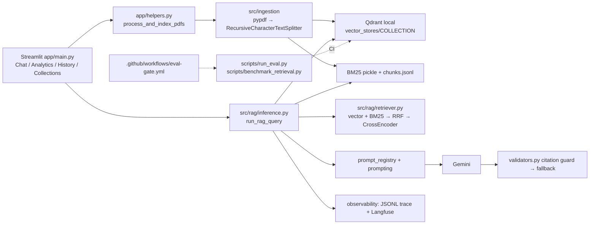

# PROJECT_AUDIT.md — DocMind (PDF-Corpus-Chat)

**Date:** 2026-10-18
**Auditor:** Buffy (Codebuff) — multidisciplinary audit (architecture, engineering, QA, security, UX, product, performance, DevOps)
**Method:** Full repository inspection, static evidence with file:line references, local test execution, and runtime reproduction where possible (Streamlit `AppTest` harness, direct function reproduction). Every finding is labelled **Confirmed** (reproduced or proven by an executed check / verified library semantics) or **Suspected** (plausible, not yet reproduced — carries a verification task, never a fix).
**Baseline verification:** `venv/Scripts/python.exe -m pytest tests/ -q` → **166 passed, 11 warnings, 30.68s** (warnings are third-party DSPy deprecations only).

**Working agreement for this document:** one issue is implemented at a time, each on its own git branch, verified, reported, and gated on explicit user approval. This file is updated per issue in the Implementation Checklist (bottom).

---

## A. Project Understanding

### Product overview
DocMind is a self-hosted, single-user Streamlit application for chatting with multiple PDFs. Users upload PDFs into **collections** (independent knowledge bases), ask questions, and receive **citation-backed answers** (`[file.pdf | page N]` per sentence) that are validated against the retrieved chunks before display. It ships with retrieval-quality tooling: a hybrid BM25 + vector retriever fused with RRF and reranked by a cross-encoder, an LLM-as-judge evaluation suite (DSPy), a golden-dataset CLI evaluator, and a GitHub Actions regression gate.

**Intended users:** researchers/knowledge workers (the author's own documents); run locally or via Docker on a trusted network. No multi-tenant, auth, or cloud-storage concepts exist by design.

### Technology stack
| Layer | Technology |
|---|---|
| UI | Streamlit 1.55 (4 tabs + sidebar), custom CSS design system (`app/styles.py`, 891 lines) |
| LLM | Google Gemini `gemini-2.5-flash` via `langchain-google-genai` |
| Embeddings | `GoogleGenerativeAIEmbeddings` (dynamic model discovery per call; default `text-embedding-004`) |
| Vector store | Qdrant **local embedded** (per-collection directory under `vector_stores/`) |
| Keyword search | Custom BM25 (`src/rag/bm25_index.py`), persisted pickle + JSONL corpus |
| Reranker | `cross-encoder/ms-marco-MiniLM-L-6-v2` (module-level singleton, lexical fallback) |
| Evaluation | DSPy 3.2 LLM-as-judge (faithfulness, context relevance, completeness), heuristic metrics, retrieval metrics |
| Observability | Langfuse (optional, guarded no-op) + local JSONL trace sink |
| Infra | Docker multi-stage build, docker-compose (app + Langfuse + Postgres), GitHub Actions |

### Architecture & data flow

### Major modules & dependencies
- `app/` — Streamlit shell: `main.py` (entry), `state.py` (session defaults), `helpers.py` (ingestion + collection CRUD), `views/chat.py` (chat + sidebar), `views/collections.py`, `views/history.py`, `views/evaluation.py`, `styles.py` (CSS). `app/eval_dashboard.py` is an **orphaned** second entrypoint (referenced nowhere).
- `src/ingestion/` — `pdf_loader.py` (per-page extraction stats), `chunking.py` (page-aware chunks).
- `src/rag/` — `inference.py` (pipeline orchestration), `retriever.py`, `fusion.py` (RRF), `reranker.py`, `bm25_index.py`, `vector_store.py`, `embeddings.py`, `prompt_registry.py`, `prompting.py`, `validators.py`.
- `src/eval/` — `evaluator.py`, `metrics.py` (DSPy), `retrieval_metrics.py`, `entailment.py`.
- `src/observability/` — `langfuse_guard.py` (all-or-nothing Langfuse activation), `tracing.py`, `store.py`.
- `scripts/` — `run_eval.py` (CLI gate, exit codes 0/1/2), `benchmark_retrieval.py` (4 strategies, recall gate), `download_fixtures.py`, Windows `setup.ps1`/`run.ps1`.
- `tests/` — 9 files, 166 tests, pure-logic only (fusion, validators, retriever, reranker, BM25, retrieval metrics, entailment, inference no-docs path, langfuse guard).

### Core user journeys
1. **Onboard a corpus:** create collection → upload PDFs → pipeline extracts/chunks/embeds → Qdrant + BM25 + `metadata.json` written → chat.
2. **Ask questions:** hybrid retrieval → Gemini → citation guard → answer with numbered citation pills, source cards, latency badges → appended to session history.
3. **Manage collections:** inspect stats, delete collections, switch active collection (sidebar + Collections tab both write `current_collection`).
4. **Review history:** filter/search session chat, export JSON/TXT, semantic document search.
5. **Evaluate:** in-app batch evaluation (Analytics tab) and CLI/CI golden-dataset gate with LLM-judge metrics + retrieval benchmark.

### How to run / test / build
- Run: `streamlit run app/main.py` (needs `.env` with `GOOGLE_API_KEY`), or `docker compose up --build` → http://localhost:8501
- Test: `pytest tests/ -v` (venv: `venv/Scripts/python.exe -m pytest tests/ -q`) — **verified: 166 passed**
- Eval CLI: `python scripts/run_eval.py --collection X --mode hybrid ...`; benchmark: `python scripts/benchmark_retrieval.py ...`
- CI: `.github/workflows/eval-gate.yml` (unit subset → fixture ingestion → eval gate → benchmark with `continue-on-error`)

---

## B. Audit Report

### B1. Confirmed bugs (executed reproduction or verified code semantics)

| ID | Sev | Issue | Evidence | Root cause | Impact | Recommended fix |
|---|---|---|---|---|---|---|
| ISSUE-001 | **P0** | Re-ingesting PDFs into an existing collection **diverges the two indexes**: Qdrant **appends** new points (langchain-qdrant `from_texts(..., force_recreate=False)` default — verified in installed source `venv/Lib/site-packages/langchain_qdrant/qdrant.py` `construct_instance()`: if the collection exists it is validated but never recreated, then points are added), while `save_chunk_corpus()` **overwrites** `chunks.jsonl` with `"w"` mode ([bm25_index.py:123](src/rag/bm25_index.py#L123)) and rebuilds BM25 from only the new batch; `metadata.json` is also overwritten ([helpers.py:121-122](app/helpers.py#L121), [helpers.py:149-153](app/helpers.py#L149)) | `app/helpers.py::process_and_index_pdfs`; verified library defaults | Upload 2 batches → duplicate vectors for re-uploaded files, BM25 serving only the newest batch, RRF double-counting duplicated chunk keys (`fusion.ingest` sums per key), Collection-tab stats showing only the last upload | Per-file replace + append (see §C decision D1) keeping Qdrant, BM25 corpus and metadata in sync |
| ISSUE-002 | P1 | In-app **batch Evaluation crashes** with `TypeError` | Reproduced: `build_report([{'question':'q'}])` → `TypeError: build_report() missing 3 required positional arguments: 'retrieval_mode', 'top_k', and 'results'`; call site [evaluation.py:201](app/views/evaluation.py#L201) passes a single positional list vs signature `build_report(collection_name, retrieval_mode, top_k, results)` ([evaluator.py:135](src/eval/evaluator.py#L135)) | Copy-paste signature drift between `app/` and `src/eval/` | "Run Evaluation" button always throws after computing answers; feature completely broken | Pass keyword args + collection/mode/top_k; add a wiring test |
| ISSUE-003 | P1 | Asking the **same question twice crashes the entire page** | Reproduced on the real entrypoint: `AppTest.from_file('app/main.py')` with two identical history entries → `streamlit.errors.StreamlitDuplicateElementKey: key='up_4944749187403701325'` | Feedback buttons keyed `f"up_{hash(question)}"` / `f"dn_{hash(question)}"` ([chat.py:469](app/views/chat.py#L469), [chat.py:476](app/views/chat.py#L476)); rendered once per history entry | Any repeated question bricks the Chat tab (all tabs render in one script) | Key by history index (e.g., `f"up_{idx}_{timestamp}"`); add AppTest regression |
| ISSUE-004 | P1 | Sidebar **"Prompt Style" selector has no effect** | Static proof: selector writes `session_state["prompt_type"]` ([chat.py:359](app/views/chat.py#L359)); the pipeline builds prompts from `session_state.prompt_version` ([inference.py:145](src/rag/inference.py#L145)); `prompt_version` is written only by `state.py` defaults and one test — nothing else (`grep -rn prompt_version`) | Two parallel state keys introduced during prompt-registry refactor | Users believe they changed prompt behavior; traces log a `prompt_style` that was not used (misleading observability) | Use one key (`prompt_version`) end-to-end; show active version in UI |
| ISSUE-005 | P1 | **Analytics tab displays fabricated metrics** | Verified: hardcoded benchmark values (`recall: 0.948` etc., [evaluation.py:64](app/views/evaluation.py#L64)), fake trend arrows "↑ +4.2% vs last run" ([evaluation.py:138](app/views/evaluation.py#L138)), and hardcoded card fallbacks (0.89/0.91/1.24/0.87) while the real baseline `evals/baselines/latest.json` is an empty scaffold (`"strategies": {}`, `"n_queries": 0`) | Demo data left in place after the real benchmark pipeline landed | Users (and stakeholders) are shown invented retrieval quality — an integrity problem for a product whose selling point is measurable quality | Decision D2: real data from baseline + session runs, honest empty states |
| ISSUE-006 | P2 | Recent-evaluations table reads **wrong keys** | [evaluation.py:101-102](app/views/evaluation.py#L101) reads `faithfulness_score` and `citation_validity.validity_ratio`; `evaluate_one()` produces `llm_metrics.*` and top-level `citation_validity_ratio` ([evaluator.py:75-83](src/eval/evaluator.py#L75)) | Key drift | Table always shows 0.00 and ⚠️ even for good runs | Read the produced keys; map `llm_metrics` when present |
| ISSUE-007 | P2 | Source-card **relevance badge never renders** | [chat.py:170](app/views/chat.py#L170) reads flat `metadata["rerank_score"]`/`metadata["score"]`; hybrid retrieval stores scores under `metadata["retrieval"]` ([retriever.py:76](src/rag/retriever.py#L76)) | Metadata shape changed when the `retrieval` sub-dict was introduced | The "▲ N% relevance" affordance is dead in the default mode; if revived, raw CE logits formatted `:.1%` would display nonsense (e.g. `−320.0%`) | Read `metadata["retrieval"]["rerank_score"]`; normalize for display |
| ISSUE-008 | P2 | History **Semantic Search cannot see the indexed collections** | [history.py:135](app/views/history.py#L135) derives collections from `chat_history` instead of `get_collections()`; the History panel's empty state `return`s from the whole `render_history_tab()`, so with no chat history the search tab is never rendered either | Copy-paste from the filter dropdown above, plus an early `return` scoped to the wrong block | A fresh session can only search `default` — and with no chat history at all it gets no collection picker and no query box | Use `get_collections()`; render History and Semantic Search as independent panels |
| ISSUE-009 | P2 | **Feedback and history are ephemeral**: 👍/👎 appends to `feedback_data` ([chat.py:470](app/views/chat.py#L470)) that is never persisted, displayed, or exported; chat history lives only in session state and is lost on refresh | grep for `feedback_data` usages (write-only) | Thumbs are a dead affordance; History tab promises a "Session chat log" only implicitly | Decision D3: persist history + feedback to disk (JSONL under a per-collection or global dir), show feedback in History |
| ISSUE-010 | P2 | **Input validation / HTML escaping gaps**: collection names are only space-sanitized (`strip().replace(" ", "_")`) yet flow into `os.makedirs`, `shutil.rmtree` and Qdrant paths → path traversal via `../` ([chat.py create-collection](app/views/chat.py), [collections.py](app/views/collections.py), [vector_store.py:14](src/rag/vector_store.py#L14)); collection names and PDF filenames are interpolated into `unsafe_allow_html` strings unescaped (`_index_status_html`, source-card `title="{fname}"`, history badges) → HTML/attribute injection | Static proof of both sinks; impact bounded to the local machine / own session, but the Docker image binds `0.0.0.0:8501` | Sanitize names to `[A-Za-z0-9_-]` (with graceful handling of pre-existing directories); HTML-escape all interpolated names |
| ISSUE-011 | P2 | **Per-query overheads**: (a) `get_embeddings()` performs a live HTTPS model-discovery call on **every invocation** ([embeddings.py:58](src/rag/embeddings.py#L58)) — one per chat query, one per semantic search, one per ingestion; (b) a new `QdrantClient(path=...)` is opened per query ([vector_store.py:37](src/rag/vector_store.py#L37)) — local mode re-opens storage and takes an **exclusive flock**, released only via GC (`__del__`), a latent `RuntimeError: Storage folder ... already accessed`; (c) BM25 search re-parses the **entire corpus JSONL on every query** ([bm25_index.py:221](src/rag/bm25_index.py#L221)) — contradicting the module docstring's claim of "no corpus re-loading" | Static proof of all three paths | Fixed latency tax on every message, growing with corpus size | Cache the embeddings factory + Qdrant client per collection (explicit close) + corpus rows; measure before/after with call-count tests |
| ISSUE-012 | P3 | **Docs & repo hygiene**: README claims an MIT `LICENSE` file that was deleted (commit `fd3d09f`); README states fixture PDFs are not committed, but 3 PDFs (~3.1 MB) are tracked; README eval defaults (`--citation-validity-threshold 0.90`) differ from CI (`0.65`); README benchmark table is empty placeholders; reranker docstring says "75 tests" (actual: 166); `app/eval_dashboard.py` is an orphaned duplicate of Analytics; unused `img/Robot.jpg` (4.3 MB), legacy `document_metadata.json` and `faiss_index/` are tracked; CI unit-test step runs only 7 of 9 test files (omits `test_entailment.py`, `test_inference.py`) | `git ls-files`, README sections, workflow step list | Trust debt: setup docs mislead; repo weight; CI blind spots | Fix README, remove/retire dead files (with approval), run all tests in CI, add an AppTest smoke test |
| ISSUE-013 | P3 | **Token/cost metrics always zero**: `token_count` is initialized ([state.py:16](app/state.py#L16)) and read ([collections.py:103](app/views/collections.py#L103)) but never written | grep `token_count` | "Total Tokens 0" / "$0.000000" cost cards are meaningless | Capture usage metadata from Gemini responses (`response.usage_metadata`) and accumulate |
| ISSUE-014 | P2 | **Found in the post-merge live-browser pass (no static analysis caught it).** (a) The active collection could not be switched by creating one, and depended on render order: the sidebar selectbox, the Collections tab's "Target Collection" selectbox and the create/delete buttons all wrote `current_collection`, and a Streamlit widget ignores `index=` once its key holds a value — so the created collection was reverted one run later and the next upload was written into the **previous** collection while the UI showed the new one. `st.tabs` renders every tab, so the Collections tab's stale value (rendered last) always won. (b) A citation pill broke its own tag: the tooltip's `\n\n` excerpt separator was inserted **before** the answer was split into paragraphs, so the tag was cut in half and the tooltip plus `">[1]` rendered as visible answer text ([chat.py `_process_citations`](app/views/chat.py)) | Reproduced on the merged stack in a real browser: created a collection, saw the badge change but the selector stay, and the upload landed in `default`; DOM inspection showed `data-tooltip="…page 1
<p style=" margin:0="` with the excerpt as text | Two silent wrong-target writes (every upload after creating a collection) and visibly corrupted answers | One source of truth for the active collection: `app/state.py::choose_collection()` re-seeds the widgets from an `on_click` callback (the only point Streamlit allows widget state to be written); selectors only write through `on_change`; a name missing on disk is resolved before anything renders it. Escape newlines in the tooltip as `&#10;` so the tag stays on one line |

### B2. Suspected issues (verification task required before any fix)
| ID | Suspect | Verification task |
|---|---|---|
| SUS-01 | Qdrant local lock collision when two clients on the same path coexist in one run (e.g., ingestion while a search client is alive) → `RuntimeError` | Write a test constructing two clients on one path; then test the ISSUE-011 client cache |
| SUS-02 | Embedding-dimension drift: dynamic model discovery may return a newer model (e.g., 3072-dim) while existing collections were built with 768-dim → retrieval/validation errors | Log the model name at ingestion into metadata; add a dimension check on load |
| SUS-03 | Hand-rolled markdown→HTML in `_process_citations` mis-renders edge cases (nested emphasis, code blocks containing `*`, `[x | page 1]` inside code) | Golden-string unit tests over `_process_citations` |
| SUS-04 | Dependency vulnerabilities (no scan tooling configured) | Run `pip-audit` against `requirements.txt` in a future issue |
| SUS-05 | Live E2E behavior with real Gemini (guard fallback, latency) never verified in this audit | Bounded manual run with API budget, or record as unverified |

### B3. Security & privacy
- **No authentication anywhere.** Dockerfile CMD binds `0.0.0.0:8501`; anyone with network reach can upload, overwrite, or delete collections. Acceptable for a localhost tool; must be documented (and optionally gated) for shared networks — **needs a product decision** (see backlog).
- **Secrets hygiene is good:** no tracked secrets (`git grep` for `AIza…`/`sk…`/hardcoded Langfuse keys → clean); `.env` gitignored and only `GOOGLE_API_KEY` + `OBSERVABILITY_ENABLED` present locally; `.env.example` is a placeholder.
- **Compose file hardcodes** `NEXTAUTH_SECRET=mysecret`, `SALT=mysalt`, Postgres `postgres/postgres`, and exposes Postgres on `5432` — fine for local dev only; must not be reused as-is on a server.
- **Injection surfaces:** PDF content flows into prompts (prompt-injection is inherent to RAG; mitigated only by prompt instructions — no tool execution follows the answer, which caps impact). Collection names/filenames no longer reach HTML or filesystem paths unsanitised (ISSUE-010 fixed): names are reduced to `[A-Za-z0-9_-]` and every interpolated value is escaped. The remaining surface is document/prompt content itself, which is displayed as escaped text.
- **Data handling:** traces write question + answer previews + chunk previews to `logs/rag_traces.jsonl` when enabled (currently enabled in local `.env`) — unredacted document content on disk; acceptable for a personal tool, worth documenting.

### B4. Reliability
- No retries/backoff in the app path: a transient Gemini 503 surfaces as `st.error("Model error: …")` and the user message is rendered but **not persisted** to history (it vanishes on the next rerun). The benchmark script has proper exponential backoff (`retry_on_transient`); the app does not.
- Citation guard is a genuine strength: <0.8 valid-citation ratio → deterministic fallback answer; validated by tests.
- Embedded Qdrant is single-process and single-writer; fine for one user, not for concurrency (and `LARGE_DATA_THRESHOLD` warns at scale).
- Failure observability exists (JSONL traces include `error` fields) but there is no log aggregation/metrics — acceptable at this scale.

### B5. Performance
| Finding | Evidence | Expected cost | Direction |
|---|---|---|---|
| HTTP model discovery per embedding call | [embeddings.py:40-63](src/rag/embeddings.py#L40) | Measured **755 ms** per call on this network — paid on every query | ~~Cache per process~~ **fixed (ISSUE-011)**: discovered model + instance memoised; 20 calls → 1 request |
| Qdrant client opened per query, lock released via GC | [vector_store.py:30-50](src/rag/vector_store.py#L30) | 12.5 ms per lookup; latent lock errors | ~~Cached client with explicit lifecycle~~ **fixed (ISSUE-011)**: one client per storage folder, 20 lookups → 0 opens, 0.41 ms each |
| Full corpus JSONL parse per query | [bm25_index.py:194-228](src/rag/bm25_index.py#L194) | 5,000 `json.loads` per query at a 5,000-chunk corpus (+12.5 ms) | ~~Cache rows with the index~~ **fixed (ISSUE-011)**: rows cached and revalidated by mtime, 0 parses on repeat |
| CrossEncoder loaded at import time | [reranker.py:76](src/rag/reranker.py#L76) | 30s test-suite import cost; slow any importing process | Keep (intentional warm-up), document; optional lazy mode |
| Unbounded `chat_history` with full `Document` objects + full re-render each rerun | [chat.py render loop](app/views/chat.py#L415) | O(history) DOM + memory growth per session | Cap history / store slim dicts (backlog) |
ISSUE-011 added call-count assertions (`tests/test_query_overhead.py`) plus a before/after probe run against both versions; the numbers above are that probe, not estimates.

### B6. Code quality & architecture
- **Strengths worth preserving:** strict separation `app/` (UI) vs `src/` (logic); the Langfuse guard pattern (single import point, no-op fallback); citation validation with guarded fallback; per-page extraction stats; versioned prompt registry; golden-dataset + CI gate; retry helper in benchmark; heavy duplication of `build_trace_record(...)` calls in `inference.py` (4 near-identical 25-line blocks) is the main maintainability wart in the pipeline.
- Duplicated collection-creation logic (sidebar vs Collections tab) with different sanitization paths; `render_stats_tab` alias kept "for backward compatibility" but unused; two parallel session keys for prompt version (ISSUE-004).
- Naming/conventions are consistent; typing is adequate for a Python Streamlit app (no mypy/ruff configured — optional backlog item).

### B7. UI/UX & accessibility
- **Works well:** dark design system with clear visual hierarchy; per-message latency badges; citation pills with hover tooltips; empty states in History; native `st.tabs`/`st.expander` navigation keeps keyboard flow functional.
- **Broken/deceiving:** Analytics fabricated data (ISSUE-005), dead prompt selector (ISSUE-004), dead relevance badges (ISSUE-007), zeroed cost cards (ISSUE-013), Collections metrics flash then disappear (`st.rerun()` immediately after rendering success metrics). Feedback is now persisted per turn and shown in Chat + History (ISSUE-009), and chat history survives a reload.
- **Accessibility gaps:** no `prefers-reduced-motion`, no `:focus-visible`/outline styling in the 891-line CSS; citation pills and tooltips are CSS hover-only (unreachable by keyboard/screen reader); icon-only buttons rely on emoji labels; contrast not audited (unverified).
- Error copy is good ("Please upload and process PDF files first…", "No usable text extracted…").

### B8. Testing & CI
- **166 tests pass** but cover pure logic only. Zero coverage of: views (the four bugs that most affect users all live here), `app/helpers.py` ingestion, `run_rag_query` happy path, and script↔module wiring (`build_report` call).
- CI runs 7 of 9 test files; `test_entailment.py` and `test_inference.py` pass locally but are omitted from the workflow.
- The `AppTest` harness used in this audit (`streamlit.testing.v1`) can drive the real `app/main.py` headlessly — the natural vehicle for view-level regression tests.
- CI benchmark step is `continue-on-error: true` (recently added for 503 flakiness) — the recall gate is therefore **informational, not blocking**; the README still describes it as blocking.

---

## C. Prioritized Improvement Roadmap

**Recorded user decisions**
- **D1 — Ingestion semantics:** per-file replace, append new (re-uploading `foo.pdf` replaces its chunks on both indexes; other files retained; no full rebuild, no naive append).
- **D2 — Analytics content:** real data from `evals/baselines/latest.json` + session evaluation runs, with honest empty states; no fabricated numbers.
- **D3 — Approved quick win:** persist chat history + 👍/👎 feedback to disk. (Working prompt selector and real token tracking remain scheduled as separate issues.)

**Issue register (implement strictly in order, one branch + approval per issue)**

| ID | Pri | Category | Problem | Solution | Verification | Status |
|---|---|---|---|---|---|---|
| ISSUE-000 | — | docs | Audit findings not recorded in repo | This document (`docs/project-audit` branch) | Document contains A–F + register | **Completed** (this commit) |
| ISSUE-001 | P0 | bug/data | Re-ingest diverges Qdrant vs BM25/metadata ([helpers.py:121](app/helpers.py#L121)) | Per-file replace + append: filter-delete Qdrant points by `metadata.source`, merge `chunks.jsonl`, rebuild BM25 once, merge `metadata.json`; injectable embeddings for tests | `tests/test_ingestion_sync.py` (replace/append/consistency/metadata-merge/legacy-row retention) + full suite ≥166 passed | **Completed** 2026-10-18 |
| ISSUE-002 | P1 | bug | Batch eval `TypeError` ([evaluation.py:201](app/views/evaluation.py#L201)) | Keyword call into `build_report`, read `summary`, persist report (no immediate rerun), opt-in LLM-judge toggle | `tests/test_eval_tab.py` (AppTest click, both paths) + suite | **Completed** 2026-10-19 |
| ISSUE-003 | P1 | bug/stability | Duplicate widget key crash on repeated question | Index-based feedback keys | AppTest regression (two identical questions) + suite | **Completed** 2026-10-19 |
| ISSUE-004 | P1 | bug | Prompt Style selector no-op | Single `prompt_version` key end-to-end; display active version | `tests/test_prompt_version_wiring.py` (prompt + trace + AppTest wiring) + browser check | **Completed** 2026-10-19 |
| ISSUE-005 | P1 | integrity/UX | Fabricated Analytics metrics (D2) | Real baseline/session data in `app/analytics.py`; empty states when absent | Unit tests on the data layer + AppTest with empty + populated artifacts | **Completed** 2026-10-20 |
| ISSUE-006 | P2 | bug | Recent-evals wrong keys | `analytics.recent_eval_rows` reads `citation_validity_ratio`, the citation counts, `latency_sec` and `llm_metrics.faithfulness.score`; status from measured scores only; table moved to full width | 21 unit tests + 3 AppTest tests on the rendered grid | **Completed** 2026-10-25 |
| ISSUE-007 | P2 | bug | Relevance badge dead | Reranker writes a normalised 0-1 `relevance` (sigmoid of the CE logit; overlap used as-is), retriever carries it in `metadata["retrieval"]`, card formats only that fraction | `tests/test_relevance_badge.py` (8 tests: normalisation, retriever metadata, label, AppTest card) + suite | **Completed** 2026-10-26 |
| ISSUE-008 | P2 | bug | Semantic-search collections from history (and unreachable with no history) | Both panels render independently; the picker lists `get_collections()` sorted, preselects the active collection, and shows an honest empty state when nothing is indexed | AppTest (fresh session, stale history collection, preselection, empty state, click-through wiring) | **Completed** 2026-10-26 |
| ISSUE-009 | P2 | feature (D3) | History + feedback ephemeral | Two append-only JSONL logs under `data/chat_history/` (`$CHAT_LOG_DIR`), restored on load; feedback keyed by turn id, newest click wins, shown in Chat and History | 14 store unit tests + 5 AppTest tests (all 5 fail pre-fix) | **Completed** 2026-10-28 |
| ISSUE-010 | P2 | security | Collection-name traversal + HTML injection | `src/rag/collection_names.py` is the single name authority: `[A-Za-z0-9_-]` allowlist, legacy dirs kept verbatim, every store/BM25/metadata/delete/create path built through a containment check. Collection names, filenames, page labels, prompt versions and search-result text escaped at every `unsafe_allow_html` sink | 26 traversal/containment/legacy/create tests + 7 escaping tests (unit + AppTest); pre-fix probe deletes a sibling directory and renders payloads raw | **Completed** 2026-10-28 |
| ISSUE-011 | P2 | perf | Per-query HTTP discovery / client open / corpus parse | Process-level caches with explicit client lifecycle: `get_embeddings()` memoises the discovered model **and** the instance; `get_qdrant_client()` shares one local client per storage folder (`evict_qdrant_client()` closes it before a delete); `load_chunk_corpus()` caches rows and revalidates the file mtime | `tests/test_query_overhead.py` (9 call-count tests); live probe: discovery 0.75 s/query → once per process, client open 12.5 ms → 0.4 ms, corpus parse 5,000 rows/query → 0 | **Completed** 2026-10-29 |
| ISSUE-012 | P3 | docs/ci | README inaccuracies, dead files, CI test subset | Fix docs; delete dead files (with approval); CI runs all tests + AppTest smoke | Doc review + workflow lint | Planned |
| ISSUE-013 | P3 | feature | Token/cost always zero | Capture Gemini `usage_metadata`, accumulate `token_count` | Unit test on accumulator | Planned |

**Deferred product decisions (require explicit user input before scheduling):** optional shared-network auth (B3, separate from the now-fixed ISSUE-010), history size caps, mypy/ruff adoption, Langfuse compose hardening.

---

## D. Implementation Summary (updated per issue)

### ISSUE-000 — audit document
- Files changed: `PROJECT_AUDIT.md` (new)
- Branch: `docs/project-audit`
- Commands executed this session and results:
  - `venv/Scripts/python.exe -m pytest tests/ -q` → **166 passed, 11 warnings (third-party), 30.68s**
  - `build_report([...])` reproduction → `TypeError: build_report() missing 3 required positional arguments` (**confirmed ISSUE-002**)
  - `AppTest.from_file('app/main.py')` with duplicated history entry → `StreamlitDuplicateElementKey: key='up_…'` (**confirmed ISSUE-003**)
  - `AppTest` button-key micro-repro → same exception class (**key-collision mechanism confirmed**)
  - `git grep` secret scan (`AIza…`, `sk…`, hardcoded Langfuse keys) → **no matches**
  - Installed-source inspection: `langchain_qdrant.qdrant.construct_instance` (`force_recreate=False` appends), `qdrant_client.local` exclusive flock, langchain-qdrant payload keys (`page_content` / `metadata`) (**foundation for ISSUE-001**)
- **Not verified / not run:** dependency CVE scan, live Gemini E2E, Docker build, runtime UI passes beyond AppTest reproductions, performance benchmarks (no baseline harness).

### ISSUE-001 — re-ingestion index divergence (P0)
- **Branch:** `fix/ISSUE-001-ingest-index-consistency`; **Files changed:** `src/rag/vector_store.py` (per-source point deletion via `metadata.source` payload filter; lock-safe `upsert_chunks()` using a single closed client; injectable `embeddings` for `build_vector_store_from_chunks`), `src/rag/bm25_index.py` (`merge_chunk_corpus()` — per-source replace, JSONL rewrite, single BM25 rebuild), `app/helpers.py` (new testable `ingest_chunks_with_stats()` orchestrating Qdrant + BM25 + merged `metadata.json`; `process_and_index_pdfs` now delegates to it), `tests/test_ingestion_sync.py` (new, 6 tests, hermetic fake embeddings + tmp cwd)
- **Semantics implemented (decision D1):** re-ingesting `foo.pdf` deletes its previous points on the vector side and replaces its corpus rows; other files' data is preserved (never re-embedded); legacy corpus rows without a `source` are retained; `metadata.json` merges per-file entries in first-seen order with recomputed totals.
- **Commands + results:** `pytest tests/test_ingestion_sync.py -q` → **6 passed** (after fixing two test-side issues found during verification: the fake embeddings must subclass `langchain_core.embeddings.Embeddings` for langchain-qdrant's constructor validation, and the "old content gone" assertion must query a token unique to the replaced text); full suite `pytest tests/ -q` → **172 passed, 11 warnings (third-party), exit 0** (baseline 166 + 6 new, no regressions); `git diff` reviewed — only the three intended files changed, `process_and_index_pdfs` return contract preserved, CI ingestion path (`build_vector_store_from_chunks` + `save_chunk_corpus`) unchanged.
- **Not verified / not run:** live Gemini ingestion with real embeddings (fake embeddings used in tests; the real-embeddings path is the pre-existing `get_embeddings()` default), Docker build.

### ISSUE-002 — in-app batch evaluation wiring (P1)
- **Branch:** `fix/ISSUE-002-eval-report-wiring`; **Files changed:** `app/views/evaluation.py` (keyword call `build_report(collection_name=…, retrieval_mode=…, top_k=…, results=…)`; success cards read `report["summary"]` and show `—` when a judge metric was not computed; report kept in `session_state["eval_report"]` and rendered outside the button branch instead of being wiped by `st.rerun()`; opt-in "Include LLM-judge metrics" checkbox forwarded to `evaluate_one`), `tests/test_eval_tab.py` (new, 2 AppTest tests), `tests/test_inference.py` (patch the loader binding `run_rag_query` actually resolves; restore `st.session_state` via monkeypatch)
- **Root causes fixed:** positional call vs 4-arg signature; success metrics read non-existent top-level keys instead of `summary`; `st.rerun()` discarded the freshly computed report and export button; the in-app evaluator never requested LLM metrics, so the faithfulness card could never be populated.
- **Commands + results:** `pytest tests/test_eval_tab.py -q` → **2 passed**; both tests **fail on pre-fix HEAD** with `TypeError: build_report() missing 3 required positional arguments` (verified by temporarily restoring HEAD's `evaluation.py`, then restoring the fix); `pytest tests/test_eval_tab.py tests/test_inference.py -q` → **3 passed**; full suite `pytest tests/ -q` → **174 passed, 11 warnings (third-party), exit 0** (baseline 172 + 2 new).
- **Not verified / not run:** live in-app run against Gemini and real collections; LLM-judge scores on the real API; Docker build.

### ISSUE-003 — duplicate widget keys on a repeated question (P1)
- **Branch:** `fix/ISSUE-003-duplicate-widget-keys`; **Files changed:** `app/views/chat.py` (feedback buttons keyed by message position instead of question text: history entries use `hist_<index>`, the in-flight answer uses `live_<len(history)>`; `_render_ai_message` / `_render_feedback_row` now take an explicit `feedback_key`), `tests/test_chat_duplicate_questions.py` (new, 4 AppTest tests)
- **Root cause fixed:** `up_{hash(question)}` / `dn_{hash(question)}` are content-derived, so two identical questions render two buttons with the same key and Streamlit raises `StreamlitDuplicateElementKey`, aborting the whole script (every tab, not just Chat). Position-based keys are unique by construction and stay stable while history is append-only.
- **Commands + results:** `pytest tests/test_chat_duplicate_questions.py -q` → **4 passed**; **all three duplicate-key tests fail on pre-fix HEAD** with `StreamlitDuplicateElementKey: key='up_…'` (verified by temporarily restoring HEAD's `chat.py`, then restoring the fix); full suite `pytest tests/ -q` → **178 passed, 11 warnings (third-party), exit 0** (baseline 174 + 4 new).
- **Not verified / not run:** manual browser click-through; persistence of feedback across reloads (ISSUE-009).

### ISSUE-004 — Prompt Style selector was a no-op (P1)
- **Branch:** `fix/ISSUE-004-prompt-version-wiring`; **Files changed:** `src/rag/inference.py` (`run_rag_query(..., prompt_version, ...)` uses the argument — not `session_state.prompt_version` — for both the prompt and every trace record; the contradictory `prompt_style` field is no longer written), `src/rag/prompt_registry.py` (`resolve_prompt_version()`; unknown/legacy versions resolve to the default so the trace can never log a version that did not run), `app/views/chat.py` (selector reads/writes `prompt_version` only, widget key `sidebar_prompt_version`, caption “Active prompt: …”, active version in the status bar and in each answer's badge row; history entries store `prompt_version`), `app/state.py` (dropped the mirrored `prompt_type` default), `app/views/history.py` (renders `prompt_version`, falls back to legacy `prompt_type`), `app/views/evaluation.py` (batch runs use the session prompt version instead of the non-existent `"standard"`, and record it in the report), `tests/test_prompt_version_wiring.py` (new, 6 tests), plus parameter renames in `tests/test_inference.py`, `tests/test_eval_tab.py`, `tests/test_chat_duplicate_questions.py`
- **Root cause fixed:** the sidebar wrote `session_state["prompt_type"]` while `run_rag_query` built prompts from `session_state["prompt_version"]`, which only the start-up defaults ever wrote. Every selection was discarded, and traces recorded `prompt_style` = the discarded value next to `prompt_version` = the version that actually ran — two contradictory fields in one record. `run_rag_query` now takes the version as its argument and derives both prompt and trace from it; `get_prompt_template`'s silent fallback is surfaced through `resolve_prompt_version`, so legacy `"standard"` logs as `v1_strict`.
- **Commands + results:** `pytest tests/test_prompt_version_wiring.py -q` → **6 passed**; **all 6 fail on pre-fix source** (v1 prompt sent while v2 was selected, trace `prompt_version=v1_strict` + `prompt_style=v2_concise`, missing `sidebar_prompt_version` widget, History badge showing `standard`) — verified by stashing `app/` + `src/`, re-running, then restoring; full suite `pytest tests/ -q` → **184 passed, 11 warnings (third-party), exit 0** (baseline 178 + 6 new). Live browser check on a local Streamlit server: selecting `v2_concise` updated both the sidebar caption and the always-visible status bar (`Hybrid · Top-4 · v2_concise`) with no console/server errors.
- **Not verified / not run:** an actual Gemini call proving the v2 text reaches the API (the model binding is stubbed and the prompt is asserted locally); Docker build.

### ISSUE-005 — fabricated Analytics metrics (P1)
- **Branch:** `fix/ISSUE-005-honest-analytics`; **Files changed:** `app/analytics.py` (new data layer: `load_benchmark`, `load_eval_reports`, `merge_reports`, `benchmark_rows`, `benchmark_caption`, `metric_cards`, `report_caption`), `app/views/evaluation.py` (cards/benchmark/provenance rendered from those functions; hardcoded strategies, trends and 0.89/0.91/1.24/0.87 fallbacks removed; empty states with the command that produces each artifact), `tests/test_analytics_data.py` (new, 16 tests), `tests/test_analytics_tab.py` (new, 3 AppTest tests)
- **What was fabricated:** `_benchmark_section()` hardcoded four strategies (recall 0.948/0.864/0.812/0.695), every card printed an invented trend (`↑ +4.2% vs last run`, `↓ −180ms improving`, `± stable`), and `baseline.get("avg_faithfulness", 0.89)` etc. fell back to demo numbers because the committed baseline is a scaffold with `strategies: {}` and none of those keys. The tab therefore always showed a made-up quality story.
- **Semantics now implemented (decision D2):** every number is read from an artifact a real run wrote — `evals/baselines/latest.json` (benchmark script) and `evals/reports/*.json` (CLI/CI eval), plus the in-session batch report, newest first. A scaffold baseline is treated as missing; a metric that was not measured shows `—` / `not measured` (faithfulness and entailment require opt-in judge runs); trends compare only against the previous report with the **same collection and retrieval mode**, and a lower latency is coloured as an improvement; benchmark coverage (`n_queries`, collection, timestamp) is stated on the section. The real repo state now renders `ci_report.json` values (1.00 / 0.80 / 6.59s, entailment `—`) with the benchmark empty state.
- **Commands + results:** `pytest tests/test_analytics_data.py -q` → **16 passed**; `pytest tests/test_analytics_tab.py -q` → **3 passed**; **all 3 AppTest tests fail on pre-fix `evaluation.py`** (empty state absent, fabricated numbers still rendered, session report ignored) — verified by stashing `app/views/evaluation.py`, re-running, then restoring; full suite `pytest tests/ -q` → **203 passed, 11 warnings (third-party), exit 0** (baseline 184 + 19 new). Live browser check on a local Streamlit server: the tab showed real `ci_report.json` values with `not measured` for entailment, `first run` trends (no comparable earlier run), and the benchmark empty state + two-line command; no console or server errors.
- **Not verified / not run:** the populated benchmark section against a freshly regenerated `evals/baselines/latest.json` (no collection/API budget; the populated path is covered by AppTest fixtures), live batch evaluation against Gemini, Docker build.

### ISSUE-006 — Recent Evaluations table read keys the evaluator never produced (P2)
- **Branch:** `fix/ISSUE-006-eval-table-keys`; **Files changed:** `app/analytics.py` (`recent_eval_rows`, `recent_eval_caption`, `PASS_THRESHOLD`, judge-score / citation-count / status helpers), `app/views/evaluation.py` (`_recent_evals_section` renders those rows; benchmark and table now stack so the table spans the page), `tests/test_eval_table_rows.py` (new, 21 tests), `tests/test_eval_table_tab.py` (new, 3 AppTest tests)
- **Root cause fixed:** the table read `r.get("faithfulness_score", 0)` and `r.get("citation_validity", {}).get("validity_ratio", 0)` — neither key exists. `evaluate_one()` writes `citation_validity_ratio` plus `citation_count` / `valid_citation_count` at the top level and judge scores under `llm_metrics` (and `None` when judging was not requested, `{"error": …}` when the judge call failed). The defaults therefore always won: every row rendered `0.00` / `0.00`, the status test `0 >= 0.7` produced ⚠️, and an unjudged run looked identical to a failing one.
- **Semantics implemented:** Faithfulness shows the judge score, or `—` when it was not measured; Citation shows the measured ratio with the counts it came from (`1/2`); status is ✅ only when **every measured** score clears 0.70, ⚠️ when any measured score is below, and `—` for a refusal (nothing to ground) or when nothing was measured. Rows are newest first, capped at 10, and a question is ellipsized only when it is actually cut. A caption states the session scope and the legend. The table moved out of the 40% column: at that width only Question and Faithfulness were visible, so the measured columns were off-screen even when populated.
- **Commands + results:** `pytest tests/test_eval_table_rows.py -q` → **21 passed**; `pytest tests/test_eval_table_tab.py -q` → **3 passed**; **2 of the 3 AppTest tests fail on the pre-fix view** (table reads `0.00` / ⚠️) — verified by stashing `app/views/evaluation.py`, re-running, then restoring; full suite `pytest tests/ -q` → **227 passed, 11 warnings (third-party), exit 0** (baseline 203 + 24 new). Live browser checks: the real app renders the Analytics tab with the new layout and the "No evaluation runs yet" state, no console or server errors; a throwaway harness that seeds `evaluate_one`-shaped session rows showed all five columns at full width with `—` (unjudged), `0.90` (judged), `0.50 (1/2)`, real latencies and `— / ✅ / ⚠️` statuses. The harness and both dev servers were removed afterwards (ports 8504/8505 have no listener).
- **Not verified / not run:** a live batch evaluation against Gemini (session rows were seeded; the table is covered by AppTest and the browser harness), Docker build.

### ISSUE-007 — source-card relevance badge never rendered (P2)
- **Branch:** `fix/ISSUE-007-relevance-badge`; **Files changed:** `src/rag/reranker.py` (`_sigmoid`; each reranked row now carries `relevance`, a 0-1 display score — sigmoid of the CE logit, or the lexical overlap fraction unchanged; the `rerank_score` docstring no longer claims it is normalised), `src/rag/retriever.py` (`metadata["retrieval"]` now carries `relevance` next to the raw scores), `app/views/chat.py` (`_relevance_label()` is the card's single badge builder; reads `metadata["retrieval"]["relevance"]` and renders `▲ 87.3% relevance`), `tests/test_relevance_badge.py` (new, 8 tests)
- **Root cause fixed:** the card read flat `metadata["rerank_score"]` / `metadata["score"]`, but hybrid retrieval stores scores under `metadata["retrieval"]` — so with the default mode the badge never rendered. Reading `retrieval["rerank_score"]` directly would have replaced "no badge" with nonsense: that value is an unbounded cross-encoder logit, and `:.1%` on it prints things like `−320.0%`. Normalisation therefore happens in the reranker, where the scorer's semantics are known, and the UI formats only a 0-1 fraction (clamped). The lexical fallback's overlap score is already a fraction, so it is passed through instead of sigmoided.
- **Semantics implemented:** the badge appears only when a display score exists. Non-hybrid modes (`similarity`, `mmr`) retrieve without scores, so their cards simply omit the badge instead of inventing one. Raw logits/`ce_score` remain in the metadata for traces and ordering.
- **Commands + results:** `pytest tests/test_relevance_badge.py -q` → **8 passed**; on the pre-fix source the module fails at import (`_relevance_label` absent), and an AppTest probe with a hybrid chunk renders `
▲ 87.3% relevance
` after the fix versus no badge line before it — verified by stashing `app/views/chat.py`, `src/rag/retriever.py`, `src/rag/reranker.py`, re-running, then restoring; full suite `pytest tests/ -q` → **235 passed, 11 warnings (third-party), exit 0** (baseline 227 + 8 new).
- **Not verified / not run:** a live query against Qdrant with the real cross-encoder weights in the Chat tab (normally covered by AppTest fixtures and by the fake-CE unit tests), Docker build.

### ISSUE-008 — Semantic Search listed chat-history collections (P2)
- **Branch:** `fix/ISSUE-008-semantic-search-collections`; **Files changed:** `app/views/history.py` (`render_history_tab()` now only owns the header and the two inner tabs; the bodies moved into `_render_history_panel()` and `_render_semantic_search_panel()`, so the History empty state returns from its own panel instead of the whole tab; the search picker is `sorted(get_collections())`, preselects `current_collection` when it exists, and shows an info empty state instead of a dead `default` picker), `tests/test_history_semantic_search.py` (new, 5 AppTest tests)
- **Root causes fixed:** (1) the dropdown was built from `chat_history`, so collections were only listed after the user had chatted in them — a collection indexed in another session or via the Collections tab was unreachable; (2) worse, the History panel returned from `render_history_tab()` when there was no history, and because `st.tabs` renders in script order that skipped the entire Semantic Search tab — a fresh session had no search UI at all, so the symptom was not merely "only `default` is selectable".
- **Semantics implemented:** the search picker shows every directory under `vector_stores/` (the same `get_collections()` source the sidebar, Collections tab and evaluator use), defaulting to the active collection via the same index-else-0 convention as the sidebar. With nothing indexed it explains where to upload instead of offering "default" (which has no store and would only produce an error). Chat history remains the source for the *history* filter dropdown, where it is correct.
- **Commands + results:** `pytest tests/test_history_semantic_search.py -q` → **5 passed**; **all 5 fail on the pre-fix view** (missing `search_collection` widget / `"default"` instead of the on-disk names / no empty-state copy) — verified by stashing `app/views/history.py`, re-running, then restoring; full suite `pytest tests/ -q` → **240 passed, 11 warnings (third-party), exit 0** (baseline 235 + 5 new).
- **Not verified / not run:** a live click-through against a real Qdrant collection (the vector-store calls are faked in the click test), Docker build.

### ISSUE-009 — chat history and 👍/👎 feedback were ephemeral (P2)
- **Branch:** `fix/ISSUE-009-history-persistence`; **Files changed:** `app/history_store.py` (new: append-only `chat_history.jsonl` + `feedback.jsonl` under `$CHAT_LOG_DIR`, default `data/chat_history/`; Documents flattened to `{page_content, metadata}` and rebuilt on load; torn lines skipped; feedback reduced to the newest click per `entry_id`), `app/state.py` (hydrates an empty `chat_history` from the log; the write-only `feedback_data` default is gone), `app/views/chat.py` (each turn gets its id before it is rendered, is appended to the log, and its thumbs persist against that id and re-render the saved verdict; Clear Chat also clears the log; a failed write is surfaced instead of swallowed), `app/views/history.py` (feedback tally, per-entry badge and header marker, `feedback` in the JSON export), `tests/test_history_store.py` (new, 14 unit tests), `tests/test_chat_persistence.py` (new, 5 AppTest tests), `tests/conftest.py` (new: autouse `CHAT_LOG_DIR` temp redirect, so tests never read or write the developer's log), `tests/test_chat_duplicate_questions.py` (thumb test now asserts the persisted record)
- **Root causes fixed:** `feedback_data` was a session-state list the 👍/👎 handlers appended to and nothing read — no display, no export, no persistence — so a click changed nothing the user or the app could observe and vanished on reload. Chat history lived only in `st.session_state`, so every answer (and its sources) was lost on refresh and the History tab could only ever show the current session.
- **Semantics implemented:** two logs, never rewritten. A turn record carries `id`, timestamp, question, answer, latency, docs, prompt version and collection; feedback records carry `entry_id` + verdict, so the same question can be asked and rated twice without collisions (the ISSUE-003 lesson applied to data, not just widget keys). The newest click per turn wins on read — a change of mind updates one verdict while both clicks stay in the log — and the Chat row shows “Marked helpful / not helpful” with the chosen thumb emphasised. History shows the tally, marks rated entries in the collapsed header and meta row, and exports the verdict. Rows without an id (hand-edited, or seeded directly into session state) fall back to a positional id so their feedback still resolves.
- **Commands + results:** `pytest tests/test_history_store.py -q` → **14 passed**; `pytest tests/test_chat_persistence.py -q` → **5 passed**; **all 5 AppTest tests fail on the pre-fix app layer** (no restore, no on-disk feedback, Clear Chat leaves the log) — verified by stashing `app/state.py`, `app/views/chat.py`, `app/views/history.py`, re-running, then restoring; full suite `pytest tests/ -q` → **259 passed, 11 warnings (third-party), exit 0** (baseline 240 + 19 new). Live check on a local Streamlit server with a seeded log: a cold page load restored the turn with its citation, source card and latency badges and showed “Marked helpful”; clicking 👎 appended a second record and the verdict switched to “Marked not helpful”; History showed “Feedback · 👍 0 helpful · 👎 1 not helpful · 1 rated” with a 👎-marked entry; a browser reload kept both the history and the new verdict; no console or server errors. Server and seeded log removed afterwards (port 8517 has no listener); no `data/` directory was created in the repo.
- **Not verified / not run:** a thumbs click on a real Gemini answer end-to-end (the model call is faked; store, UI and reload paths are real), concurrent multi-process writes (one Streamlit process per session here), Docker build.

### ISSUE-010 — collection-name traversal and unescaped HTML (P2)
- **Branch:** `fix/ISSUE-010-collection-name-safety`; **Files changed:** `src/rag/collection_names.py` (new: `sanitize_collection_name()` allowlists `[A-Za-z0-9_-]` and falls back to `default`; `resolve_collection_name()` keeps a name that already exists on disk so legacy directories do not move; `contained_path()`/`collection_path()` join under a base directory and assert the result stays inside it), `src/rag/vector_store.py` (Qdrant directory **and** collection name come from the resolver; the local space-only sanitizer is gone), `src/rag/bm25_index.py` (the corpus and pickled index are built through the same containment), `app/helpers.py` (`create_collection()` is now the single creation path — both views call it; `delete_collection()` resolves once before deleting, so a legacy name cannot lose its `metadata/` twin to a re-sanitised path; metadata load and ingestion use contained paths), `app/views/chat.py` (sidebar create form, status bar, sidebar badge, source cards, reference list, citation tooltip and latency badge escaped; citation names are kept raw so they are escaped exactly once), `app/views/collections.py` (create form + indexed-file lists escaped), `app/views/history.py` (badges escaped; semantic-search result card extracted to `_search_result_html()` and escaped, including chunk text), `tests/test_collection_safety.py` (new, 26 tests), `tests/test_html_escaping.py` (new, 7 tests)
- **Root causes fixed:** the only validation was `strip().replace(" ", "_")`, applied inconsistently, and the result was interpolated into `os.makedirs`, `shutil.rmtree`, the Qdrant path, the BM25 corpus path and `metadata.json`'s directory — so `../x` escaped the store, and deleting such a name removed a directory outside it. Separately, names and filenames went straight into `unsafe_allow_html` strings, including an HTML attribute (`title="{fname}"`) and PDF text into the semantic-search cards.
- **Semantics implemented:** one authority for names. New names are reduced to a single `[A-Za-z0-9_-]` component (spaces still become `_`, matching the old behaviour); a name that already exists under `vector_stores/` is used verbatim, because `os.listdir` entries are single components and a legacy `paper.v2` must keep its store, its metadata and its Qdrant collection name. Deletion resolves the name **once** and then builds both paths, so removing the store first cannot redirect the `metadata/` path. Escaping is done once per sink from raw data; `_process_citations` unescapes the citation text it reads out of the already-escaped answer so the reference list and tooltip do not double-escape.
- **Commands + results:** `pytest tests/test_collection_safety.py -q` → **26 passed**; `pytest tests/test_html_escaping.py -q` → **7 passed**; full suite `pytest tests/ -q` → **292 passed, 11 warnings (third-party), exit 0** (baseline 259 + 33 new). Fail-before-fix proven against the pre-fix app layer (stash `app/`, `src/`, probe, restore): `delete_collection("../victim")` **deleted a sibling directory outside `vector_stores/`**, `get_collection_dir("../../etc")` resolved to `<tmp>/etc`, and the source-card attribute, history badge and latency badge all embedded the raw `` payload. Real-store probe: all 8 existing collections resolve to their own directories unchanged.
- **Not verified / not run:** a live browser session (escaping is asserted on the rendered HTML strings via AppTest, not on pixels), traversal behaviour on a case-insensitive filesystem other than this Windows checkout, Docker build.

### ISSUE-011 — per-query overheads: discovery, client open, corpus parse (P2)
- **Branch:** `fix/ISSUE-011-query-overhead`; **Files changed:** `src/rag/embeddings.py` (`get_embeddings()` returns a cached instance per provider/model; `_discover_google_model()` memoises the model-list request — including a failed attempt — and honours a `GOOGLE_EMBEDDING_MODEL` pin; `clear_embeddings_cache()` for tests), `src/rag/vector_store.py` (`get_qdrant_client()` shares one local client per storage folder, `evict_qdrant_client()`/`close_all_qdrant_clients()` close it explicitly; `load_vector_store()` no longer opens a client per call; `build_vector_store_from_chunks()` creates the collection through the shared client instead of `from_texts(path=…)`, which would open a second client and keep its exclusive lock; `upsert_chunks()` uses the shared client), `src/rag/bm25_index.py` (`load_chunk_corpus()` caches rows per collection, revalidated by file mtime; writers refresh the cache; `forget_corpus_cache()`), `app/helpers.py` (`delete_collection()` evicts the client and corpus cache before removing the folders), `tests/conftest.py` (autouse fixture closes cached clients after each test), `tests/test_ingestion_sync.py` (the inspection helper uses the shared client), `tests/test_query_overhead.py` (new, 9 tests)
- **Root causes fixed:** (a) `get_embeddings()` rebuilt the embeddings object **and** performed a live `GET /v1beta/models` request every time it was called — once per chat query, per semantic search and per ingestion; the request blocks the script run, so every message waited for it. (b) `load_vector_store()` opened a new `QdrantClient(path=…)` per call; local mode takes an exclusive lock released only at GC, so a second client on the same folder raised `RuntimeError: Storage folder … already accessed` (SUS-01), and the open itself cost ~12 ms. (c) `bm25_search_collection()` re-parsed the whole JSONL corpus after every query just to map hit indexes back to metadata.
- **Semantics preserved:** the cached corpus is revalidated against the file mtime, so a rewrite by another process is still observed; writers update the cache immediately. Deleting a collection closes the client first (required on Windows) and drops the corpus cache. Ingestion still embeds only the new chunks (ISSUE-001).
- **Commands + results:** `pytest tests/test_query_overhead.py -q` → **9 passed**; full suite on this branch (based on `main`) → **301 passed, exit 0**. Measured with a probe that runs identically on both versions (500-chunk store, 5,000-chunk corpus, 20 calls each):

| per-query work | before | after |
|---|---|---|
| `get_embeddings()` ×20 | 20 objects, **20** discovery HTTP calls (~**755 ms** each, live) | 1 object, **1** call; 0.003 ms after |
| `load_vector_store()` ×20 | **20** client opens, 12.46 ms/call | **0** opens, 0.41 ms/call |
| `bm25_search_collection()` ×20 | **100,000** `json.loads` (5,000/query), 32.2 ms/query | **0** parses, 19.7 ms/query |

  Net effect at those sizes: about **0.78 s removed from every message** (≈755 ms network + 12 ms client open + 12.5 ms parse), and the double-client `RuntimeError` is now structurally impossible.
- **Live browser verification on this branch:** started the app, created `e2e_011`, uploaded the 2-page test PDF through the real uploader (real Gemini embeddings, 3072-dim collection created by the new code path), asked “What is the containment field tolerance?” → grounded answer (0.5 metres, page 2) with retrieval 0.59 s, then deleted the collection **from the UI while the app held the shared client** — folders removed, no error in the server log (this is the Windows case the eviction fixes). `default` was not touched.
- **Not verified / not run:** concurrent multi-process writers to the same collection (the client cache is per process, by design), Docker build.
### ISSUE-014 — active-collection state and citation-pill markup (P2)
- **Branch:** `fix/ISSUE-014-collection-state-and-pills`; **Files changed:** `app/state.py` (`current_collection()`, `set_current_collection()`, `choose_collection()` — re-seeds the three display selectors and re-seeds the two list pickers —, `forget_collection_pickers()`, `sync_collection_from_widget()`), `app/views/chat.py` (`_create_collection_callback()` on the sidebar create button; the badge, the selector's index and the upload target all read `current_collection()`; a name missing from `get_collections()` is resolved to the first existing collection before anything renders it; the create button no longer does a redundant rerun; tooltip newlines encoded), `app/views/collections.py` (`_create_collection_callback`, `_delete_collection_callback` falling back to a surviving collection; the Target selectbox no longer writes the active collection unconditionally), `app/views/history.py` (semantic-search picker reads and updates the active collection), `app/styles.py` (tooltip `white-space: pre-line` so the encoded newline still renders as the two-line card), `tests/test_collection_selection.py` (new, 5 tests), `tests/test_citation_pills.py` (new, 6 tests)
- **Root cause fixed (a):** `st.selectbox` returns its **stored** value once its key exists; `index=` applies only on first render. Three widgets wrote `current_collection` from their own value each run, so (1) `create_collection()` was reverted on the very next run and every later upload went to the previously active collection while the badge suggested otherwise, and (2) because `st.tabs` builds all children, the Collections tab (last) overwrote the sidebar's selection on **every** run — the active collection was a function of render order, not of user intent. Fixed by making `current_collection` the only source of truth, switching it inside `on_click` callbacks (which run before widgets are created, the only place Streamlit permits widget state assignment) and having selectors write only through `on_change`.
- **Root cause fixed (b):** `_process_citations()` injected the pill, then split the answer on blank lines to build `
` blocks. The tooltip embeds the matched excerpt with `\n\n`, so the pill's `[1]`; the browser then parsed the remainder as text and the answer displayed `…47 secon…">[1]`.
- **Commands + results:** `pytest tests/test_collection_selection.py tests/test_citation_pills.py -q` → **11 passed**; full suite `pytest tests/ -q` → **303 passed, 11 warnings (third-party), exit 0** (baseline 292 + 11 new). Fail-before-fix: with `app/` stashed, **7 of the 11 fail** (`test_tooltip_newline_is_entity_encoded`, `test_pill_tag_is_not_split_across_paragraphs`, `test_tooltip_cannot_close_its_own_attribute`, `test_creating_a_collection_activates_it`, `test_collections_tab_does_not_clobber_the_active_collection`, `test_sidebar_selection_updates_the_active_collection`, `test_active_collection_survives_a_noop_rerun`).
- **Live browser verification (the merged stack had never been driven):** real `streamlit run app/main.py` on `127.0.0.1:8523` with a generated 2-page PDF (`Aurora_Protocol_Spec.pdf`, distinctive facts) uploaded through the real `file_uploader` (DataTransfer + `change` event, so the actual widget path is used). Verified: upload → ingest → 2 chunks in Qdrant + BM25 + `metadata.json`; grounded answer (47 s, 120 m, Zephyr-9 900 cycles) with citation pills rendering `[1]` and no leaked markup; relevance badges 100% / 35.4% (ISSUE-007); prompt-version + latency badges; 👍 persisted and restored as "Marked helpful" after a page reload (ISSUE-009); History list, feedback summary and export buttons; semantic search returning the correct page (ISSUE-008); Analytics honest empty states (ISSUE-005/006); creating a collection now activates it in the badge, both sidebar/Collections target selectors and the semantic-search picker, and the following upload landed in the new collection; deleting the active collection fell back to a live one with every selector agreeing.
- **Not verified / not run:** non-Windows filesystems, Docker build, a second concurrent browser session (Streamlit widget identity is per session).
- **Data left as found:** the test PDF was removed from `default` afterwards (corpus 39 → 37 rows, its `metadata.json` entry dropped, the Qdrant collection my upload created deleted) and both throwaway collections deleted; `default`'s **pre-existing** inconsistency (37 corpus rows with no vectors at all — the Qdrant collection had never existed) is unchanged and is reported below as ISSUE-015.

### ISSUE-015 — corpus and vectors can disagree without anyone noticing (P3, reported not fixed)
- **Evidence:** `vector_stores/default/` held `chunks.jsonl` + `bm25_index.pkl` for 37 chunks of `Science-ML-2015.pdf`, and `metadata/metadata.json` claimed those chunks were indexed, while the collection directory contained **no Qdrant collection at all** (its `collection/` subdirectory was created only when this pass uploaded a PDF). Hybrid retrieval still returned those chunks through the BM25 channel, so the failure was invisible; similarity/MMR search and the "Chunks 37" stat were not.
- **Why it matters:** ISSUE-001 made re-ingestion per-source, which is correct, but nothing reconciles a store that predates the fix (or was reset/partially deleted). The UI reports corpus/metadata totals as if they were vector counts.
- **Suggested fix (needs a decision):** a `doctor`/repair path that counts Qdrant points per source and either re-embeds the missing sources (costs API budget) or reports the drift in the Collections tab, plus storing the embedding model/dimension per collection (SUS-02).

---

## E. Product Enhancement Backlog

**Quick wins (Now/Next)**
1. **Conversation persistence** (ISSUE-009) — ✅ done: History is restored across restarts and feedback is durable/actionable; metric met: history survives reload; feedback rows show state.
2. **Honest Analytics** (ISSUE-005) — trust in the quality story; metric: zero hardcoded numbers in `app/`.
3. **Answer streaming / typing feedback** (Later-ish, needs `streamlit` + langchain streaming) — perceived latency; metric: time-to-first-token displayed.
4. **Empty-state coaching** — Chat tab shows "No collection has documents yet → upload here" with a button when the store is empty, instead of a generic prompt.

**Strategic (Later)**
5. **Retrieval quality loop:** use persisted 👎 feedback (`data/chat_history/feedback.jsonl`) + failed citation guards to suggest golden-dataset additions (human-in-the-loop eval growth). Metric: golden set growth per month.
6. **Optional auth** for shared/Docker deployments (env-var password or reverse-proxy guide). Metric: documented secure deployment path.
7. **Streaming + suggested follow-ups** per answer (chips generated from chunk metadata). Metric: follow-up click rate.
8. **Per-file document management** (list/replace/delete single PDFs inside a collection) — natural extension of ISSUE-001's per-file identity.
9. **Charts for eval history** (the orphaned `eval_dashboard.py` functionality merged into the Analytics tab) — trend lines over `evals/reports/*.json`.
10. **Cost/latency budget card** per session once ISSUE-013 lands.

Avoid: notification loops, gamification, multi-tenant features — none fit a personal research tool.

---

## F. Readiness Scorecard

Scoring: 1–5, evidence-based. "Unverified" is used where this audit could not gather evidence.

| Area | Score | Evidence |
|---|---|---|
| Functional correctness | **2 / 5** | Core chat/RAG path sound (guard + tests), but 1 P0 data-integrity bug and 2 P1 user-facing crashes/broken features confirmed |
| Security | **3 / 5** (local context) | No secrets in git, guarded Langfuse, safe fallbacks; name traversal and HTML-injection sinks closed (ISSUE-010); still no auth (bounded by local single-user intent, but Docker binds all interfaces) |
| Reliability | **3 / 5** | Guarded fallbacks, structured traces, no retries in app path, error-path messages vanish from history, embedded-store concurrency limits |
| Code quality | **3.5 / 5** | Clear layering, strong observability guard, tests for pure logic; duplicated trace blocks, dead modules, key/state drift |
| Performance | **3 / 5** | Sound architecture for corpus sizes at hand; fixed per-query taxes (HTTP discovery, client open, corpus parse) proven in code |
| UX & accessibility | **2.5 / 5** | Polished visual system; fabricated metrics + several dead affordances; no reduced-motion/focus styling, hover-only tooltips |
| Test coverage | **2.5 / 5** | 166 passing tests, all on pure logic; zero view/ingestion/wiring coverage — exactly where the confirmed bugs live; CI runs a 7/9 subset and the recall gate is non-blocking |
| Deployment readiness | **3 / 5** | Docker build path exists; README drift (LICENSE, thresholds), compose secrets hardcoded, no healthcheck/non-root user |
| Product maturity | **2.5 / 5** | Strong, differentiated core (hybrid + citation validation + eval gate) undermined by broken analytics/eval UI and data-integrity risk |

**Overall:** a well-architected personal RAG tool with credible quality engineering bones; **not production-ready** until ISSUE-001 (data integrity), ISSUE-002/003 (crashes), and ISSUE-005 (integrity of displayed metrics) are fixed. Local + automated verification only; no staging/production claims are made anywhere in this audit.

---

## Implementation Checklist (living)

| Issue | Branch | Commit | Verification | Status |
|---|---|---|---|---|
| ISSUE-000 audit document | `docs/project-audit` | (this commit) | Sections A–F present; every finding cites evidence | ✅ Completed 2026-10-18 |
| ISSUE-001 re-ingest sync | `fix/ISSUE-001-ingest-index-consistency` | (this commit) | `tests/test_ingestion_sync.py` 6 passed; full suite **172 passed**, exit 0 | ✅ Completed 2026-10-18 |
| ISSUE-002 batch eval wiring | `fix/ISSUE-002-eval-report-wiring` | (this commit) | `tests/test_eval_tab.py` 2 passed (fail on pre-fix HEAD); full suite **174 passed**, exit 0 | ✅ Completed 2026-10-19 |
| ISSUE-003 duplicate widget keys | `fix/ISSUE-003-duplicate-widget-keys` | (this commit) | `tests/test_chat_duplicate_questions.py` 4 passed (3 fail on pre-fix HEAD); full suite **178 passed**, exit 0 | ✅ Completed 2026-10-19 |
| ISSUE-004 prompt version wiring | `fix/ISSUE-004-prompt-version-wiring` | (this commit) | `tests/test_prompt_version_wiring.py` 6 passed (all 6 fail on pre-fix source); full suite **184 passed**, exit 0; browser check | ✅ Completed 2026-10-19 |
| ISSUE-005 honest analytics | `fix/ISSUE-005-honest-analytics` | (this commit) | `tests/test_analytics_data.py` 16 + `tests/test_analytics_tab.py` 3 passed (3 AppTest tests fail on pre-fix view); full suite **203 passed**, exit 0; browser check | ✅ Completed 2026-10-20 |
| ISSUE-006 recent-eval table keys | `fix/ISSUE-006-eval-table-keys` | (this commit) | `tests/test_eval_table_rows.py` 21 + `tests/test_eval_table_tab.py` 3 passed (2 AppTest tests fail on pre-fix view); full suite **227 passed**, exit 0; browser check of empty + seeded table | ✅ Completed 2026-10-25 |
| ISSUE-007 relevance badge | `fix/ISSUE-007-relevance-badge` | (this commit) | `tests/test_relevance_badge.py` 8 passed (badge absent on pre-fix card, import error on pre-fix source); full suite **235 passed**, exit 0; AppTest card check | ✅ Completed 2026-10-26 |
| ISSUE-008 semantic-search collections | `fix/ISSUE-008-semantic-search-collections` | (this commit) | `tests/test_history_semantic_search.py` 5 passed (all 5 fail on pre-fix view); full suite **240 passed**, exit 0 | ✅ Completed 2026-10-26 |
| ISSUE-009 history + feedback persistence | `fix/ISSUE-009-history-persistence` | (this commit) | `tests/test_history_store.py` 14 + `tests/test_chat_persistence.py` 5 passed (all 5 AppTest tests fail on pre-fix app layer); full suite **259 passed**, exit 0; browser check of restore, thumbs and reload | ✅ Completed 2026-10-28 |
| ISSUE-010 collection-name safety | `fix/ISSUE-010-collection-name-safety` | (this commit) | `tests/test_collection_safety.py` 26 + `tests/test_html_escaping.py` 7 passed (pre-fix probe: sibling-directory delete, `../../etc` store escape, three raw HTML sinks); full suite **292 passed**, exit 0 | ✅ Completed 2026-10-28 |
| ISSUE-011 per-query caches | `fix/ISSUE-011-query-overhead` | (this commit) | `tests/test_query_overhead.py` 9 passed; full suite **301 passed**, exit 0; probe before/after (discovery 20→1 calls, client opens 20→0, corpus parses 100,000→0); live ingest + query + UI delete | ✅ Completed 2026-10-29 |
| ISSUE-014 active-collection state + pill markup | `fix/ISSUE-014-collection-state-and-pills` | (this commit) | `tests/test_collection_selection.py` 5 + `tests/test_citation_pills.py` 6 passed (7 fail on pre-fix app layer); full suite **303 passed**, exit 0; full live-browser pass: upload → ingest → chat with citations → 👍 → reload → history/search/analytics → create → upload into the new collection → delete | ✅ Completed 2026-10-29 |
| ISSUE-015 corpus/vector drift in `default` | — | — | Reported, not fixed: 37 corpus rows with no vectors, left exactly as found | 📝 Needs decision |
| ISSUE-012 … ISSUE-013 | — | — | — | ⛔ Pending |
